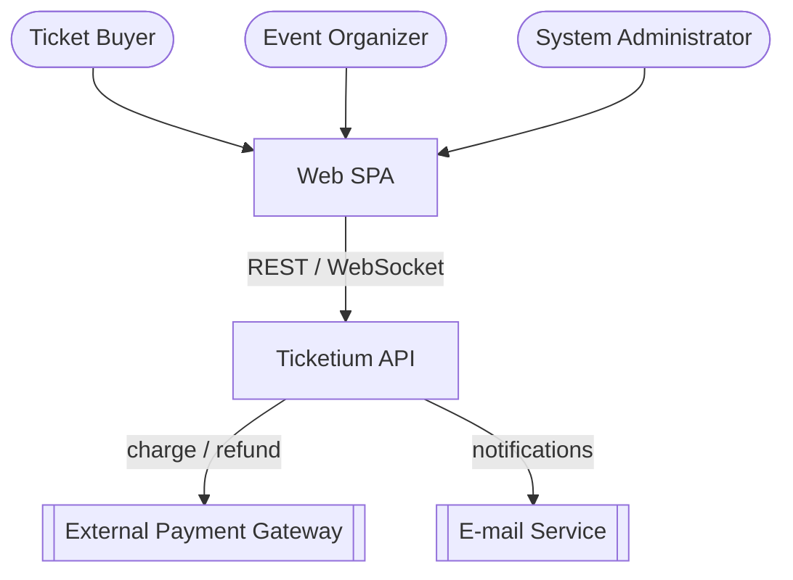
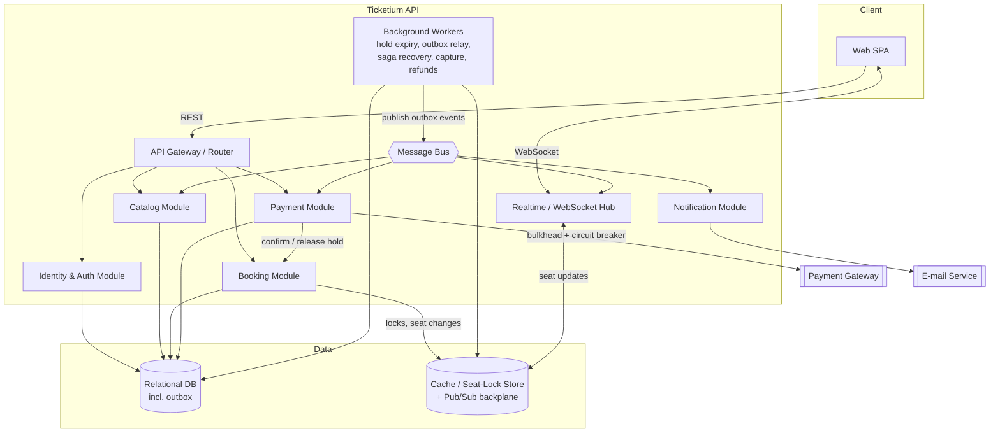
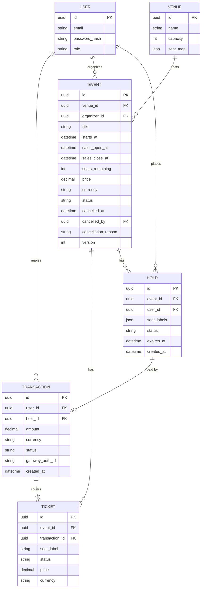
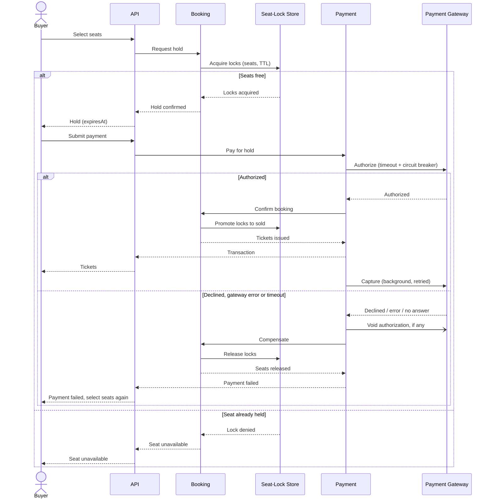

# Ticketium — Architecture

This document describes the architectural style and design of Ticketium using
**Diagram-as-Code** (Mermaid), which renders natively in GitHub Markdown.

## 1. Architectural Style

Ticketium is delivered as a **cloud-hosted application** with:

- A **Single Page Application (SPA)** front end communicating over REST and WebSockets.
- A **modular backend** (modular monolith) exposing one API, with clear internal module
  boundaries — Identity/Auth, Catalog, Booking, Payment — that can be split into separate
  deployable services later if scale demands it.
- A **relational database** as the system of record for strong booking consistency.
- A **cache / distributed-lock store** for time-limited seat holds, also used as the
  pub/sub backplane that spreads real-time updates across API instances.
- A **transactional outbox** and an internal **message bus** for event-driven side effects
  (notifications, refunds, seat-availability updates), processed by **background workers**
  hosted in every API instance.
- Resilient integration with an **external payment gateway** via a circuit breaker, and an
  **e-mail service** for buyer and organizer notifications.

This style keeps early development simple while preserving a clean path toward a
microservice/serverless split under load.

## 2. System Context

## 3. Container / Component View

Modules that change state write an event to the outbox table in the same database
transaction; the outbox relay publishes it to the message bus, and each subscriber reacts on
its own (e.g. tickets e-mailed, capacity updated, refunds started). Seat changes reach
browsers through one path: they are published to the pub/sub backplane (holds and releases
by Booking, sales by the Realtime Hub's handler of the bus event), and every instance's hub
pushes them to its own WebSocket connections. The Payment module changes holds and seat
locks only through the Booking module. See [Concurrency Patterns](./CONCURRENCY_PATTERNS.md)
for the flows.

## 4. Data Model

Six core entities: **User**, **Event**, **Venue**, **Hold**, **Ticket**, **Transaction**.

- A **Hold** is the durable record of a checkout reservation with status `Active`, `Paid`,
  `Released` or `Expired`. The seat-lock store guarantees that a seat belongs to only one
  hold at a time; the database keeps the hold's lifecycle, so the API can tell an expired
  hold (`410`) from a paid one (`409`). A released hold keeps its record for audit but no
  longer exists for the API (`404`).
- An **Event** sells the seats of its venue's seat map, so its capacity is the size of that
  map; `seats_remaining` is maintained by the Catalog. `Cancelled` and `SoldOut` are stored
  in `status`; `Scheduled`, `OnSale`, `SalesClosed` and `Started` follow from `sales_open_at`,
  `sales_close_at`, `starts_at` and the database clock, so no job has to flip them.
  `version` is the event's `ETag`.
- A **Transaction** moves `Authorized → Captured`; when its event is cancelled it becomes
  `Voided` (not yet captured) or `RefundPending → Refunded`. `gateway_auth_id` is the
  gateway reference used to capture, void and refund. A **Ticket** is `Valid`, and becomes
  `Cancelled` and then `Refunded` if its event is cancelled.
- Money values are stored as an amount plus an ISO 4217 currency code, matching the
  `Money` object of the API.
- Supporting tables of the concurrency patterns (`checkout_sagas`, `idempotency_keys`,
  `outbox`, `processed_messages`, refund checkpoints) are described in
  [Concurrency Patterns](./CONCURRENCY_PATTERNS.md) and omitted from the diagram.

## 5. Key Flow — Concurrency-safe Seat Booking

The booking flow is the heart of the system. A seat is **held** for a limited time during
checkout; a **saga** compensates by releasing the hold when payment fails or times out.
A payment is executed as **authorize, then capture**: the gateway first authorizes the amount,
the booking is confirmed, and only then is the payment captured (in the background), so a
failed checkout voids an authorization instead of refunding money (see
[Concurrency Patterns S2](./CONCURRENCY_PATTERNS.md#2-s2-paying-for-a-hold-checkout-saga)).

## 6. Distributed & Resiliency Patterns

| Pattern                      | Where / Why |
|------------------------------|-------------|
| Distributed Lock / Seat Hold | Lock a seat during checkout to prevent double-selling. |
| Saga (compensation)          | Release the held seat if payment fails or expires. |
| Try/Confirm/Cancel           | Reserve seats (hold) and money (authorization) before confirming either. |
| Idempotency Key              | Make payment retries safe: one charge per checkout. |
| Transactional Outbox         | Publish side effects (e-mails, capacity, refunds) reliably after a commit. |
| Circuit Breaker + Bulkhead   | Protect against payment-gateway failures and cap concurrent gateway calls. |
| Real-time Streaming          | Push "seats remaining" updates to clients over WebSockets. |

These and the other patterns used (balking, barrier, readers-writer lock, reactor and more)
are applied in detail, with sequence diagrams, in
[Concurrency Patterns](./CONCURRENCY_PATTERNS.md).

## 7. Evolution Path

The modular boundaries allow extracting high-load modules (e.g., Booking) into independent
services, and moving event-driven work (hold expiry, notifications) to **serverless**
functions, without changing the public API contract.
