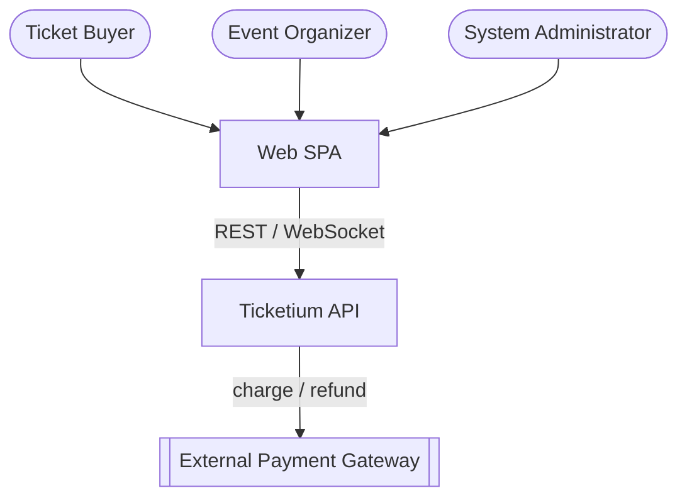
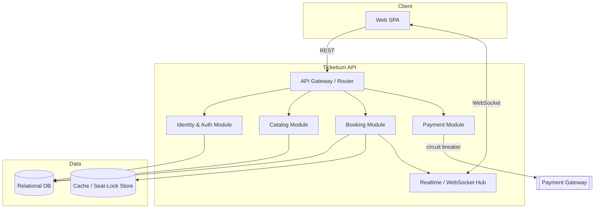
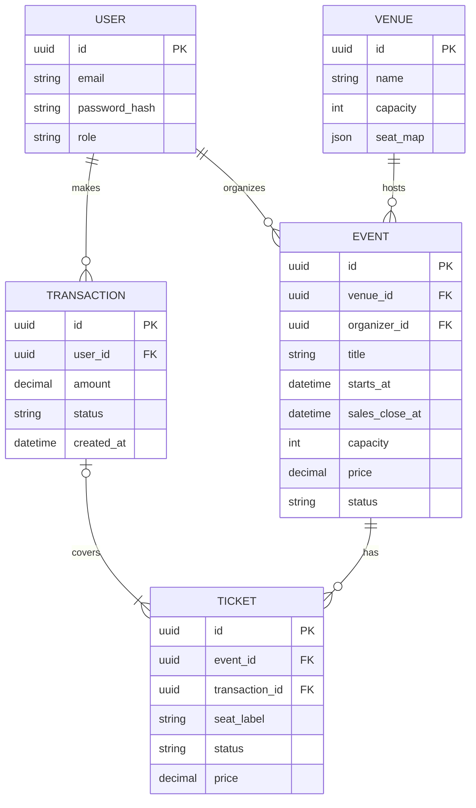
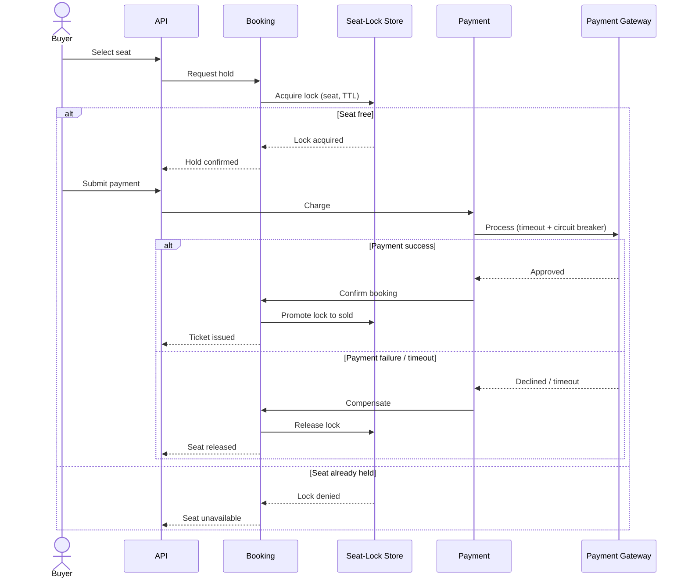

# Ticketium — Architecture

This document describes the architectural style and design of Ticketium using
**Diagram-as-Code** (Mermaid), which renders natively in GitHub Markdown.

## 1. Architectural Style

Ticketium is delivered as a **cloud-hosted application** with:

- A **Single Page Application (SPA)** front end communicating over REST and WebSockets.
- A **modular backend** (modular monolith) exposing one API, with clear internal module
  boundaries — Identity/Auth, Catalog, Booking, Payment — that can be split into separate
  deployable services later if scale demands it.
- A **relational database** as the system of record for strong booking consistency.
- A **cache / distributed-lock store** for time-limited seat holds.
- Resilient integration with an **external payment gateway** via a circuit breaker.

This style keeps early development simple while preserving a clean path toward a
microservice/serverless split under load.

## 2. System Context

## 3. Container / Component View

## 4. Data Model

Five core entities: **User**, **Event**, **Venue**, **Ticket**, **Transaction**.

## 5. Key Flow — Concurrency-safe Seat Booking

The booking flow is the heart of the system. A seat is **held** for a limited time during
checkout; a **saga** compensates by releasing the hold when payment fails or times out.

## 6. Distributed & Resiliency Patterns

| Pattern                      | Where / Why |
|------------------------------|-------------|
| Distributed Lock / Seat Hold | Lock a seat during checkout to prevent double-selling. |
| Saga (compensation)          | Release the held seat if payment fails or expires. |
| Circuit Breaker              | Protect against payment-gateway timeouts and failures. |
| Real-time Streaming          | Push "seats remaining" updates to clients over WebSockets. |

Each pattern is applied in detail, with sequence diagrams, in
[Concurrency Patterns](./CONCURRENCY_PATTERNS.md).

## 7. Evolution Path

The modular boundaries allow extracting high-load modules (e.g., Booking) into independent
services, and moving event-driven work (hold expiry, notifications) to **serverless**
functions, without changing the public API contract.
