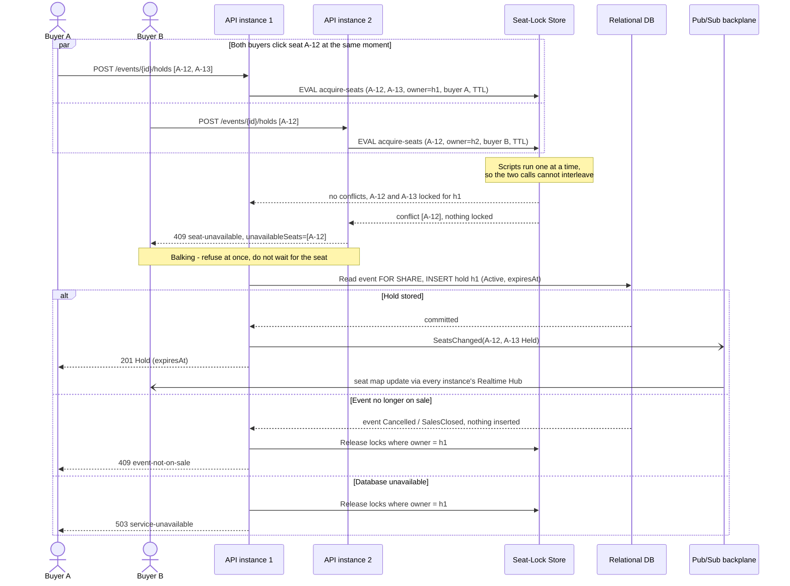
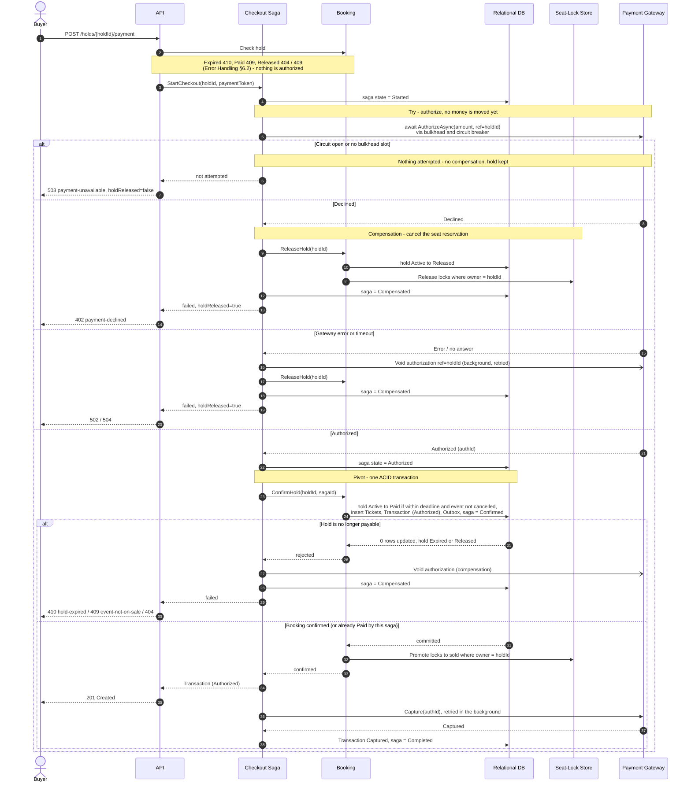
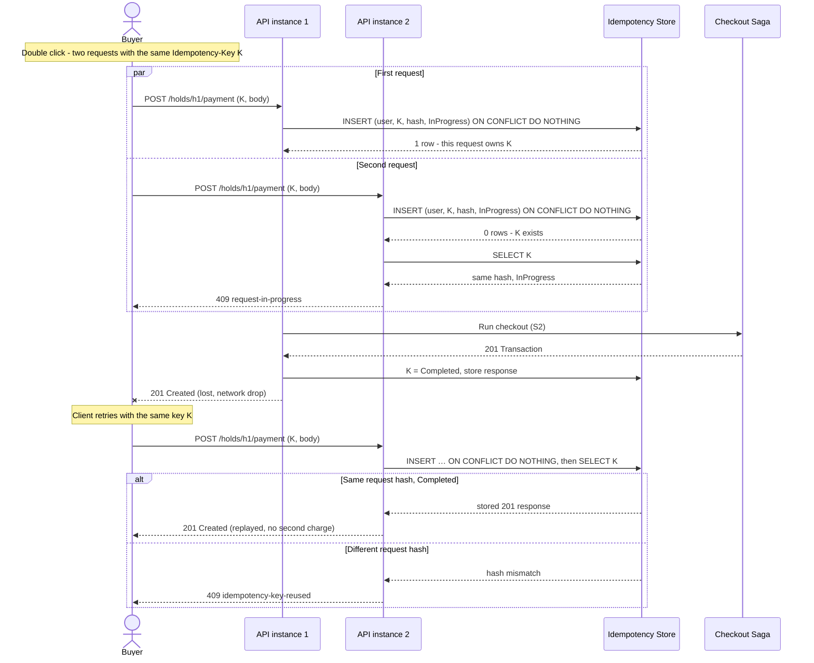
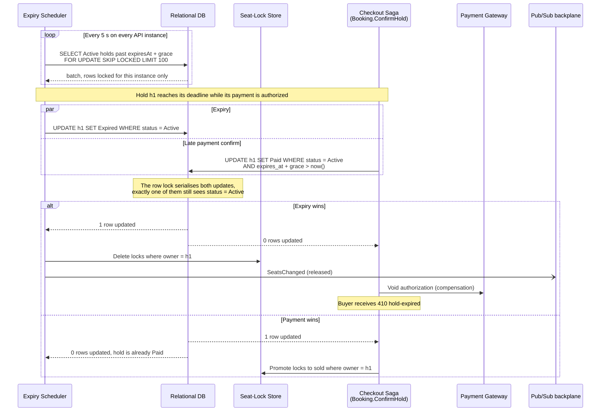
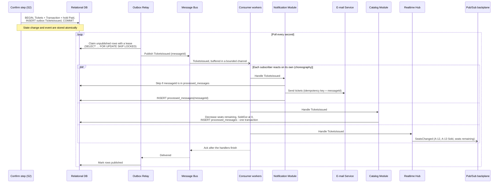
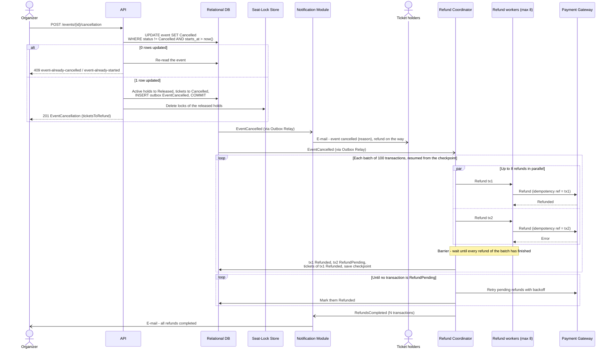
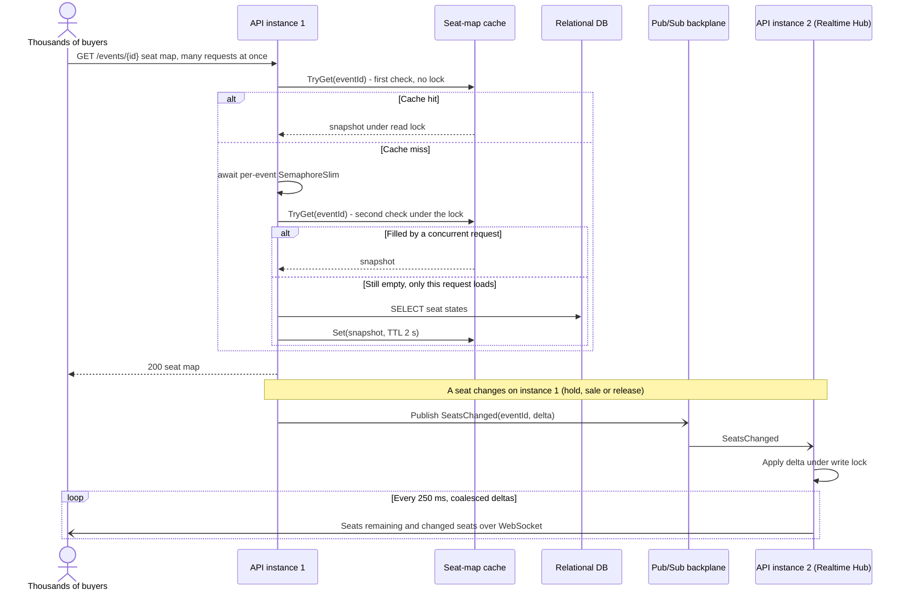

# Ticketium: Concurrency Patterns

This document shows where Ticketium applies **concurrency** and **distributed transaction**
patterns. Each of the seven scenarios below gives the problem, the patterns used and how
they are applied, a Mermaid sequence diagram, and the design decisions.

## 1. S1: Two Buyers Hold the Same Seat

**Problem.** Buyer A and Buyer B click seat `A-12` at the same moment. Their requests reach
different API instances. Exactly one buyer may get the seat, and a hold of several
seats must be all-or-nothing ([Error Handling §6.1](./ERROR_HANDLING.md#61-holds)).

### Patterns and how they are applied

- **Distributed Lock as a lease.** Each seat is a key in the seat-lock store
  (`seat:{eventId}:A-12`), and its value is the id of the hold that owns it. The lock has a
  TTL longer than the hold's payment deadline (hold time plus the payment grace period of
  [S4](#4-s4-hold-expiry-races-a-late-payment), plus a safety margin), so a crashed instance
  cannot block a seat forever, yet the lock never ends while a payment can still succeed.
  The `{eventId}` hash tag puts all keys of an event in one cluster slot, so one script can
  touch several seats.
- **Atomic operation.** All requested seats are checked and set by **one server-side
  script**. The store runs scripts one at a time, so concurrent requests are serialised and
  never interleave. Locking seats one by one would allow partial holds, and two buyers
  locking `A-12, A-13` and `A-13, A-12` in opposite order would deadlock. The atomic script
  removes both problems.
- **Atomic hold limit.** The same script keeps, per buyer and event, a sorted set of the
  buyer's held seats (`holds:{eventId}:{userId}`) scored by the lock expiry time. It first
  drops entries whose expiry has passed, then checks the limit of 6 before locking
  anything. Two parallel requests of one buyer (e.g. from two browser tabs) therefore
  cannot exceed the limit together: the second one gets `422 hold-limit-exceeded`. The
  release, expiry and promotion scripts remove the seats from the set in the same atomic
  step in which they remove or promote the locks, and a lock that simply runs out of TTL
  leaves an entry that the next check drops, so the limit can never stick.
- **Balking.** If a seat is already taken, the request **balks**: it fails immediately with
  `409 seat-unavailable` and lists the conflicting seats. It does not wait for the seat to
  become free (Guarded Suspension), because a hold can last minutes and the buyer can pick
  another seat right away.
- **TCC Try step.** The hold is the *Try* step of Try/Confirm/Cancel. It reserves the resource
  without selling it. *Confirm* (promote to sold) and *Cancel* (release) happen in
  [S2](#2-s2-paying-for-a-hold-checkout-saga) and [S4](#4-s4-hold-expiry-races-a-late-payment).
- **Re-check under the event row lock.** The hold row is inserted in a transaction that
  reads the event row `FOR SHARE` and checks that the event is still on sale. Cancellation
  ([S6](#6-s6-event-cancellation-with-mass-refunds)) updates the same row, so the two are
  serialised: a hold either commits before the cancellation (and is released by it) or sees
  the event as cancelled and gives its locks back.
- **Fencing by owner id.** Release and promotion are compare-and-set operations (`only if
  value = holdId`). A stale request cannot delete a lock that now belongs to another hold.

Design decisions:

- **Fail closed.** If the lock store is unreachable, the API returns
  `503 service-unavailable` and never books without a lock.
- The lock is the fast arbiter between concurrent buyers. The database hold record is the
  durable state used by checkout and expiry ([S4](#4-s4-hold-expiry-races-a-late-payment)).
- A unique index on valid tickets (`(event_id, seat_label) WHERE status = 'Valid'`) is the
  last line of defence: even a bug in the lock path cannot produce two valid tickets for one
  seat.

## 2. S2: Paying for a Hold (Checkout Saga)

**Problem.** Paying for a hold changes three systems: the payment gateway (money), the
relational database (tickets, transaction, hold status) and the seat-lock store (seat
becomes sold). They cannot share one ACID transaction, the gateway does not support
two-phase commit, and every call can fail or time out.

### Patterns and how they are applied

- **Saga Orchestration.** A *Checkout Saga* orchestrator in the Payment module runs the
  steps in order and records the saga state (`Started → Authorized → Confirmed → Completed`
  or `Compensated`) in the database after each step. If an instance crashes, a recovery
  worker resumes unfinished sagas from their last state. Orchestration fits here because
  the steps have a strict order and the buyer waits for one clear result. The saga changes
  holds and seat locks only through the Booking module (`ConfirmHold`, `ReleaseHold`), which
  owns them.
- **Single runner per saga.** A saga row carries an owner and a lease (`locked_until`). The
  request that started it, the recovery worker and a retried request that took over the
  idempotency key ([S3](#3-s3-duplicate-and-retried-payment-requests)) all claim the saga with
  a conditional `UPDATE … WHERE locked_until < now()`, so only one of them runs it at a time.
- **TCC (Try / Confirm / Cancel).** Both resources are reserved before anything becomes
  final:

  | Resource | Try | Confirm | Cancel |
  |----------|-----|---------|--------|
  | Seats | hold (S1) | hold `Paid`, locks promoted to `sold` | release locks, hold `Released` |
  | Money | authorize | capture | void authorization |

- **Pivot transaction.** *Confirm booking* is a single local ACID transaction. It sets the
  hold `Active → Paid` (only if the hold is still within its payment deadline and its event
  is not cancelled), inserts the tickets and the transaction (status `Authorized`), writes
  an outbox message ([S5](#5-s5-ticket-issuance-side-effects)) and sets the saga to
  `Confirmed`. Because the saga state is part of the same commit, a resumed saga always
  knows whether the pivot happened. If the conditional update matches 0 rows, the saga
  re-reads the hold: when it is already `Paid` by this saga (a resumed run), it continues;
  otherwise it compensates. Before this pivot every step can be compensated. After it, the
  remaining steps (promote locks, capture) are only retried and never undone, and the API
  answers `201` straight away.
- **Compensation, not rollback.** A declined or failed authorization cannot be "rolled
  back". The saga runs a semantic undo instead: release the seats and void the
  authorization. Compensations are idempotent, because they can be retried after a crash.
- **Async/await with Future/Promise.** Gateway calls are `async`. The orchestrator awaits
  a `Task` (the Future), with a timeout via `CancellationToken`, so no thread is blocked
  during the gateway's latency or while waiting for a bulkhead slot. During a drop, many
  checkouts can wait at the same time while using only a few threads.
- **Bulkhead.** All gateway calls of an instance pass a concurrency limiter sized so that
  all instances together stay below the gateway's rate limit. A checkout that cannot get a
  slot within a short wait returns `503 payment-unavailable` and keeps its hold. Refunds
  ([S6](#6-s6-event-cancellation-with-mass-refunds)) use their own, smaller limiter and their
  own circuit breaker, so a refund run can neither starve checkouts nor open the checkout
  circuit.
- **Circuit Breaker and Retry.** Calls go through the breaker described in
  [Error Handling §6.2](./ERROR_HANDLING.md#62-payment). When the circuit is open, nothing
  was attempted, so the saga does not compensate and the hold is kept.

Design decisions:

- **Why not Two-Phase Commit:** the external gateway cannot take part in 2PC. 2PC would
  also make the coordinator a critical dependency and hold seat locks while it waits on a
  slow third party. The saga gives eventual consistency and never blocks other buyers.
- Authorize-then-capture keeps "money taken, no ticket" impossible in the normal path. If a
  capture keeps failing after the pivot, the reconciliation job finishes it, because the
  booking is already final. The buyer is not kept waiting for the capture.
- The gateway reference is derived from `holdId`. If the saga is re-run after a crash,
  the gateway deduplicates the authorization (see [S3](#3-s3-duplicate-and-retried-payment-requests)).

## 3. S3: Duplicate and Retried Payment Requests

**Problem.** The buyer double-clicks *Pay*, or the network drops the `201` response and
the SPA retries. Without protection the same hold could be charged twice, possibly by two
API instances running at the same time.

### Patterns and how they are applied

- **Idempotency key.** Every payment request carries an `Idempotency-Key`
  ([Error Handling §6.2](./ERROR_HANDLING.md#62-payment)). The server stores the key with a
  hash of the request (method, path and body) and, after completion, the response. A retry
  with the same key and request gets the stored response replayed: *1st request → SUCCESS,
  2nd request → ALREADY PROCESSED*. Hashing the path means a key reused for another hold is
  rejected instead of replaying the other hold's result.
- **Atomic insert-if-absent.** Ownership of a key is decided by the database, not by
  application code. `INSERT … ON CONFLICT DO NOTHING` on the primary key `(user_id, key)`
  is atomic, so among concurrent requests exactly one inserts the row and runs the checkout.
- **Balking.** A request whose key is still `InProgress` does not wait for the first one to
  finish. It returns `409 request-in-progress` at once. The SPA does not resend: it waits for
  the response to its first request and retries with the same key only if that response is
  lost.
- **Only completed checkouts are stored.** `503` (no authorization attempted, or a
  dependency unreachable) and `500` are not stored for the key. The key is released, so the
  client's retry with the same key runs the checkout again instead of replaying the failure.
- **Lease on the in-progress record.** The row has a `locked_until` time. If the owning
  instance crashes, a later retry can take over the key with a conditional
  `UPDATE … WHERE locked_until < now()`. It then claims the saga from S2 the same way, and
  the saga state decides whether to resume or compensate.

Design decisions:

- Keys are scoped per user, so one buyer cannot replay another buyer's response.
- Idempotency is applied end to end: the API deduplicates client retries, and the saga
  passes a stable reference to the gateway, so the gateway deduplicates the saga's own
  retries.
- Keys are kept for 24 hours, longer than any realistic client retry window.

## 4. S4: Hold Expiry Races a Late Payment

**Problem.** A hold lives about 10 minutes. Expired holds must free their seats
promptly so other buyers can take them. A buyer can also submit payment in the last
second, so the expiry job and the checkout saga may change the same hold at the same time.
Several API instances run the expiry job, and each expired hold must be handled once.

### Patterns and how they are applied

- **Scheduler.** Every API instance hosts the expiry worker as a `BackgroundService` driven
  by a `PeriodicTimer` (every 5 s). A scheduler decides *when* work runs, separately from the
  request threads that create holds.
- **Competing consumers with `SKIP LOCKED`.** Each run claims a batch of expired holds with
  `SELECT … FOR UPDATE SKIP LOCKED`. Instances never block each other and never process
  the same hold twice, and no leader election is needed.
- **Compare-and-set.** Both writers use a conditional `UPDATE` that succeeds only if the
  hold is still `Active`. The database row lock serialises them, and the number of affected
  rows (1 or 0) decides the winner. The confirm step also checks the payment deadline, so
  the **deadline is enforced by the condition itself**. A delayed sweeper only delays
  cleanup and never allows a late sale.
- **Deadline with a payment grace period.** A payment must *start* before `expiresAt`;
  later it gets `410 hold-expired` without any authorization. Because authorizing can take
  seconds, the confirm step and the sweeper both use `expires_at + grace` (e.g. 30 s), so a
  payment that started in time is not lost to a slow gateway.
- **Compensation.** The loser of the race undoes its own side effects. If expiry wins, the
  checkout voids its payment authorization and returns `410 hold-expired`.
- **Distributed Lock TTL as safety net.** The seat-lock TTL is longer than the payment
  deadline (S1). The database decides first. If every sweeper were down, the locks would
  still expire by themselves and the seats would go back on sale.

Design decisions:

- A buyer's own `DELETE /holds/{holdId}` uses the same conditional update, so a release
  racing with payment behaves the same way: whoever commits first wins. A release after
  payment returns `409 hold-already-paid`; a payment after the release returns `404`.
- The expiry time is checked against the database clock, not the API instance clocks,
  so clock drift between instances cannot extend a hold.

## 5. S5: Ticket Issuance Side Effects

**Problem.** After a successful checkout several modules must react: the buyer receives
the tickets by e-mail, the Catalog updates the remaining capacity (and sets `SoldOut` at
zero), and connected clients see the new seat state. Publishing these events
directly after the commit is unsafe. If the process dies between the commit and the
publish, the event is lost. If the event is published first and the commit then fails,
the event describes something that never happened.

### Patterns and how they are applied

- **Transactional Outbox.** The confirm transaction from S2 also inserts a
  `TicketsIssued` row into an `outbox` table. The business change and the event commit
  **atomically**: both are stored or neither is. A separate *Outbox Relay* claims
  unpublished rows and publishes them to the message bus (in-process today, a broker once
  modules are extracted, see [Architecture §7](./ARCHITECTURE.md#7-evolution-path)). It
  marks a row as published only after the bus has accepted the message: with the in-process
  bus that is after every subscriber's handler has finished, with a broker after the broker
  has persisted it.
- **Saga Choreography.** No central coordinator exists here. Each module subscribes to
  `TicketsIssued` and does its own local work, so adding a new reaction (e.g. analytics)
  does not change the checkout. Choreography fits because the reactions are independent
  and none of them can fail the purchase.
- **Producer-Consumer with a Thread Pool.** The relay is the producer, the bus queue is the
  buffer, and each subscriber host runs a pool of N consumer workers that read from a
  **bounded** `Channel<T>`. When the workers fall behind, the channel is full and the
  relay stops claiming new rows. This back-pressure keeps memory flat during a drop.
- **Idempotent consumer.** The relay guarantees *at-least-once* delivery: a crash after
  publishing but before marking the row as published sends the message again. Handlers that
  only change the database record the message id in a `processed_messages` table in the same
  transaction as their change and skip ids they have already seen, which makes their effect
  happen exactly once. An e-mail cannot join that transaction: the Notification module sends
  it with the message id as the e-mail service's idempotency key and records the id
  afterwards. A crash in between can at worst send the same e-mail twice; it can never lose
  one.

## 6. S6: Event Cancellation with Mass Refunds

**Problem.** An organizer cancels an event with thousands of sold tickets.
Cancellation must happen exactly once even if the organizer double-clicks or sends it from
two devices at the same time. Sales and holds must stop, ticket holders must be told, and
every transaction must be refunded through the gateway, which limits request rates. Refunds
can fail one by one, the process can restart in the middle, and the organizer needs a
reliable "all refunds done" signal.

### Patterns and how they are applied

- **Balking with an atomic state transition.**
  `UPDATE events SET status = 'Cancelled' WHERE status != 'Cancelled' AND starts_at > now()`
  succeeds for one request only. A concurrent or repeated cancellation balks: it re-reads
  the event and returns `409 event-already-cancelled` or `event-already-started`. The same
  transaction marks the active holds `Released` and the valid tickets `Cancelled`. The event
  row lock serialises the cancellation with hold inserts (S1) and with the confirm step of
  every checkout (S2): a checkout racing the cancellation loses at its pivot, voids its
  authorization and gets `409 event-not-on-sale`.
- **Transactional Outbox + Choreography.** The transaction writes an `EventCancelled`
  outbox message. The API answers `201` straight away with `ticketsToRefund`. The
  Notification module e-mails every ticket holder the cancellation notice with the
  organizer's reason, and a Refund Coordinator starts the refunds, each reacting to the
  message on its own, as in S5.
- **Thread Pool (bounded parallelism) and Bulkhead.** Refunds run on at most 8 parallel
  workers, with their own concurrency limit and circuit breaker (S2). That is fast enough
  for thousands of transactions and stays below the gateway rate limit without starving
  checkouts of other events.
- **Barrier.** Transactions are refunded in batches of 100. All workers of a batch must
  reach the barrier before the coordinator saves the batch result and a progress
  checkpoint and starts the next batch. Each transaction is saved as `Refunded` or, if the
  gateway failed, `RefundPending`; pending refunds are retried with backoff until none is
  left. After a restart the coordinator resumes from the last checkpoint instead of from the
  beginning, and "refunds completed" is reported only when no transaction is pending.
- **Idempotency.** Each refund uses the transaction id as its gateway idempotency key.
  A batch that is re-processed after a crash cannot refund the same transaction twice.
- **Void instead of refund.** A transaction whose background capture (S2) has not happened
  yet is still `Authorized`; the coordinator voids it instead of refunding it. The gateway
  serialises operations on one authorization: if the capture wins, the void is rejected and
  the coordinator refunds instead.

## 7. S7: Real-time Seat Availability During a Ticket Drop

**Problem.** When sales open, thousands of buyers load the same seat map at once and stay
connected for live updates. Reads must stay under 300 ms at p95, a
cache miss must not send thousands of identical queries to the database, and a seat
change on one API instance must reach buyers connected to any instance.

### Patterns and how they are applied

- **Reactor.** The Realtime Hub serves thousands of WebSocket connections with
  non-blocking I/O. The server's event loop waits for I/O readiness on all sockets and
  dispatches each ready event to a handler that runs on the thread pool. A
  thread-per-connection design would need one thread per buyer.
- **Double-checked locking.** Each instance caches seat-map snapshots for a short time. On
  a miss, the first check runs without a lock. Then the request takes a per-event
  `SemaphoreSlim` and **checks again**, so only the first request queries the database and
  the others reuse its result. This prevents a cache stampede at the moment of the drop.
- **Readers-writer lock.** The in-memory snapshot of an event is read by many requests and
  written only when a seat-change delta arrives. A `ReaderWriterLockSlim` lets all readers
  proceed in parallel and gives the writer exclusive access while it applies the delta. The
  lock is held only around the synchronous copy or update of the snapshot, never across an
  `await`, because `ReaderWriterLockSlim` is bound to the thread that took it.
- **Publish-Subscribe backplane.** Every seat change is published to a pub/sub channel:
  holds and releases (S1, S4) right after their commit, sales by the Realtime Hub's
  `TicketsIssued` handler (S5). Every instance subscribes, updates its snapshot and pushes
  to its own connections. Publishing is best-effort: a lost delta is repaired when the
  snapshot is reloaded after its TTL.
- **Scheduler (coalescing).** Deltas are buffered and sent to clients every 250 ms in one
  message. During a drop with hundreds of changes per second this keeps the push rate per
  connection bounded.

Message contract: clients connect to `wss://api.ticketium.example/ws/events/{eventId}` and
receive `SeatsChanged` messages of the form
`{ "eventId": "…", "seatsRemaining": 142, "changes": [{ "label": "A-12", "status": "Held" }] }`,
where `status` uses the `Seat` values of the REST API (`Available`, `Held`, `Sold`). After a
reconnect the client reloads the seat map with `GET /events/{eventId}`.

Design decisions:

- The seat map is **read-optimised and may lag slightly** (at most the cache TTL plus the
  coalescing interval). Correctness does not depend on it: the authoritative check is
  always the atomic lock in S1, so a stale map can only lead to a `409 seat-unavailable`,
  never to a double sale.
