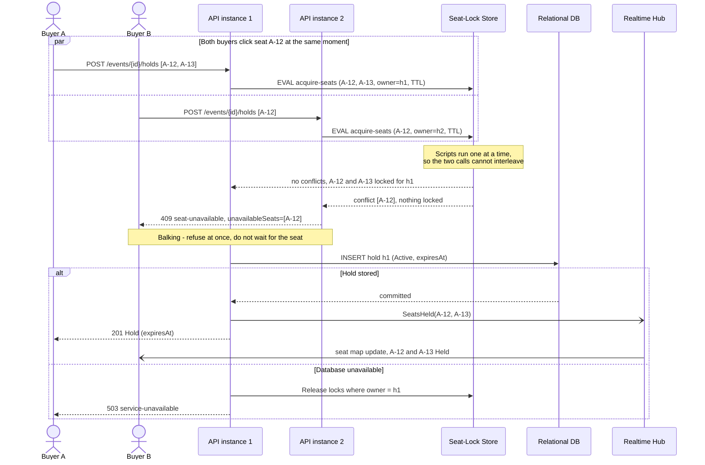
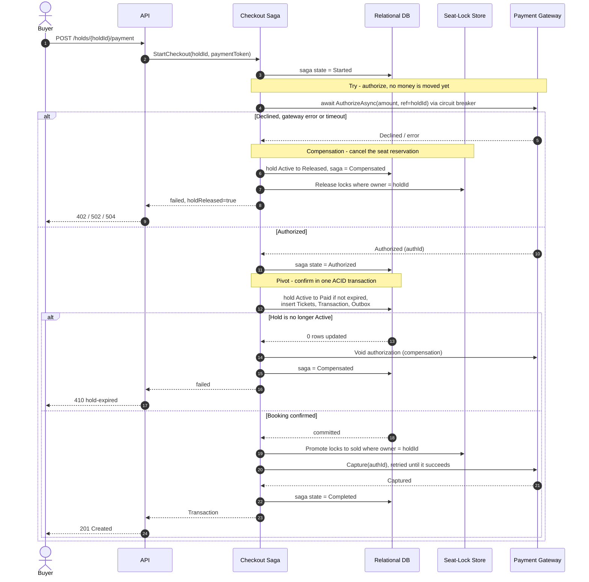
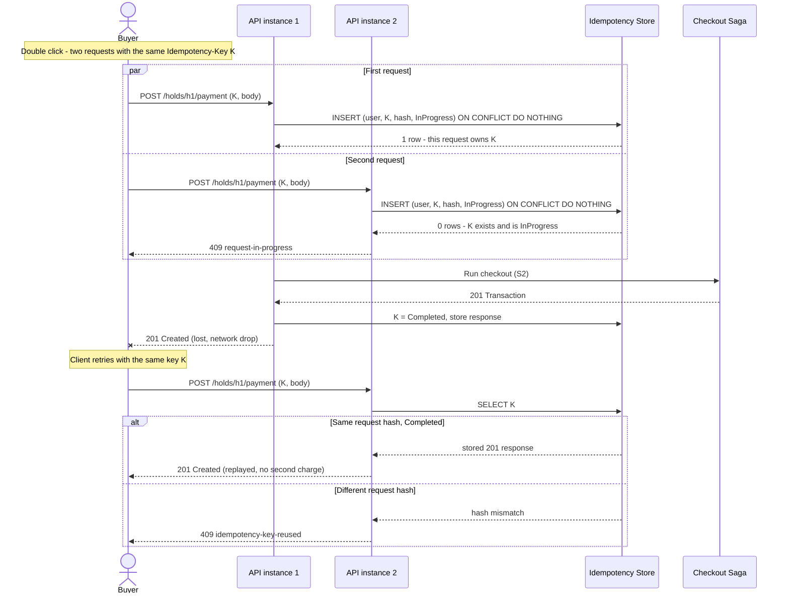
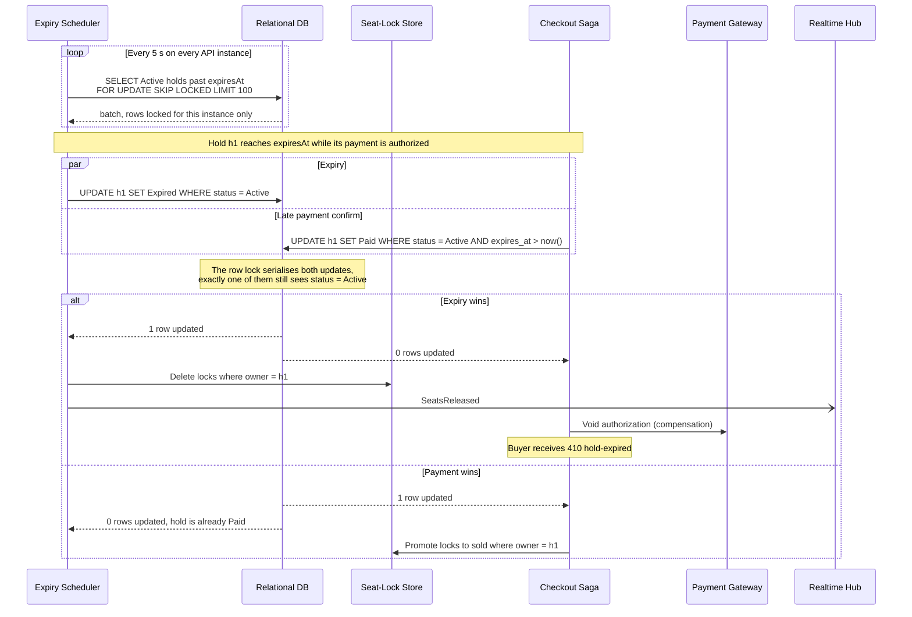
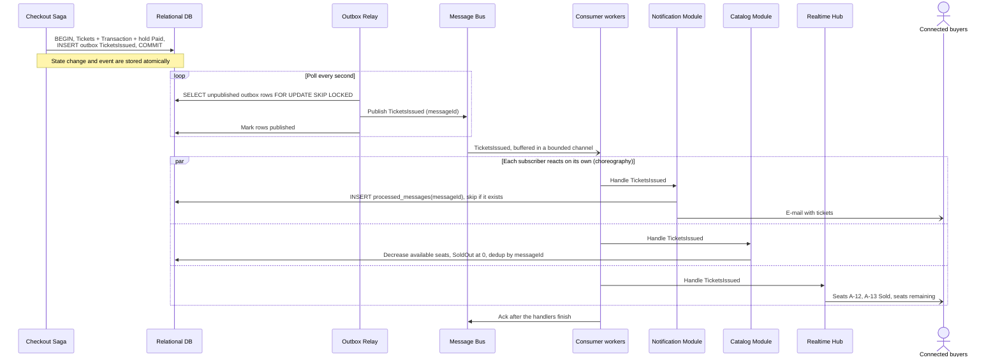
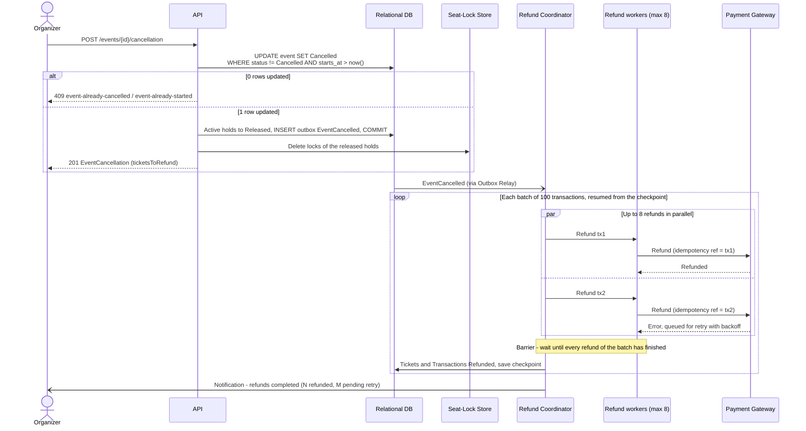
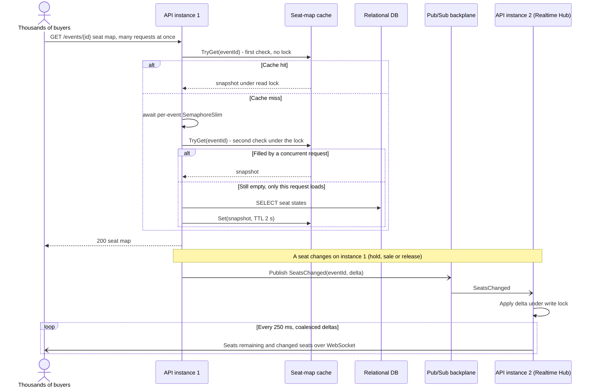

# Ticketium: Concurrency Patterns

This document shows where Ticketium applies **concurrency** and **distributed transaction**
patterns. Each of the seven scenarios below gives the problem, the patterns used and how
they are applied, a Mermaid sequence diagram, and the design decisions.

## 1. S1: Two Buyers Hold the Same Seat

**Problem.** Buyer A and Buyer B click seat `A-12` at the same moment. Their requests reach
different API instances. Exactly one buyer may get the seat, and a hold of several
seats must be all-or-nothing ([Error Handling §6.1](./ERROR_HANDLING.md#61-holds)).

### Patterns and how they are applied

- **Distributed Lock as a lease.** Each seat is a key in the seat-lock store
  (`seat:{eventId}:A-12`), and its value is the id of the hold that owns it. The lock has a TTL
  (hold time plus a grace period), so a crashed instance cannot block a seat forever. The
  `{eventId}` hash tag puts all seats of an event in one cluster slot, so one script can
  touch several seats.
- **Atomic operation.** All requested seats are checked and set by **one server-side
  script**. The store runs scripts one at a time, so concurrent requests are serialised and
  never interleave. Locking seats one by one would allow partial holds, and two buyers
  locking `A-12, A-13` and `A-13, A-12` in opposite order would deadlock. The atomic script
  removes both problems.
- **Balking.** If a seat is already taken, the request **balks**: it fails immediately with
  `409 seat-unavailable` and lists the conflicting seats. It does not wait for the seat to
  become free (Guarded Suspension), because a hold can last minutes and the buyer can pick
  another seat right away.
- **TCC Try step.** The hold is the *Try* step of Try/Confirm/Cancel. It reserves the resource
  without selling it. *Confirm* (promote to sold) and *Cancel* (release) happen in
  [S2](#3-s2-paying-for-a-hold-checkout-saga) and [S4](#5-s4-hold-expiry-races-a-late-payment).
- **Fencing by owner id.** Release and promotion are compare-and-set operations (`only if
  value = holdId`). A stale request cannot delete a lock that now belongs to another hold.

Design decisions:

- **Fail closed.** If the lock store is unreachable, the API returns
  `503 service-unavailable` and never books without a lock.
- The lock is the fast arbiter between concurrent buyers. The database hold record is the
  durable state used by checkout and expiry ([S4](#5-s4-hold-expiry-races-a-late-payment)).
- A unique index on sold tickets `(event_id, seat_label)` is the last line of defence: even
  a bug in the lock path cannot produce two valid tickets for one seat.

## 2. S2: Paying for a Hold (Checkout Saga)

**Problem.** Paying for a hold changes three systems: the payment gateway (money), the
relational database (tickets, transaction, hold status) and the seat-lock store (seat
becomes sold). They cannot share one ACID transaction, the gateway does not support
two-phase commit, and every call can fail or time out.

### Patterns and how they are applied

- **Saga Orchestration.** A *Checkout Saga* orchestrator in the Payment module runs the
  steps in order and records the saga state (`Started → Authorized → Confirmed → Completed`
  or `Compensated`) in the database after each step. If an instance crashes, a recovery
  worker resumes unfinished sagas from their last state. Orchestration fits here because
  the steps have a strict order and the buyer waits for one clear result.
- **TCC (Try / Confirm / Cancel).** Both resources are reserved before anything becomes
  final:

  | Resource | Try | Confirm | Cancel |
  |----------|-----|---------|--------|
  | Seats | hold (S1) | hold `Paid`, locks promoted to `sold` | release locks, hold `Released` |
  | Money | authorize | capture | void authorization |

- **Pivot transaction.** *Confirm booking* is a single local ACID transaction. It sets the
  hold `Active → Paid`, inserts tickets and the transaction, and writes an outbox message
  ([S5](#6-s5-ticket-issuance-side-effects)). Before this pivot every step can be
  compensated. After it, the remaining steps (promote locks, capture) are only retried and
  never undone.
- **Compensation, not rollback.** A declined or failed authorization cannot be "rolled
  back". The saga runs a semantic undo instead: release the seats and void the
  authorization. Compensations are idempotent, because they can be retried after a crash.
- **Async/await with Future/Promise.** Gateway calls are `async`. The orchestrator awaits
  a `Task` (the Future), with a timeout via `CancellationToken`, so no thread is blocked
  during the gateway's latency. During a drop, thousands of checkouts can wait on the
  gateway at the same time while using only a few threads.
- **Circuit Breaker and Retry.** Calls go through the breaker described in
  [Error Handling §6.2](./ERROR_HANDLING.md#62-payment). When the circuit is open, nothing
  was attempted, so the saga does not compensate and the hold is kept.

Design decisions:

- **Why not Two-Phase Commit:** the external gateway cannot take part in 2PC. 2PC would
  also make the coordinator a critical dependency and hold seat locks while it waits on a
  slow third party. The saga gives eventual consistency and never blocks other buyers.
- Authorize-then-capture keeps "money taken, no ticket" impossible in the normal path. If a
  capture keeps failing after the pivot, the reconciliation job finishes it, because the
  booking is already final.
- The gateway reference is derived from `holdId`. If the saga is re-run after a crash,
  the gateway deduplicates the authorization (see [S3](#4-s3-duplicate-and-retried-payment-requests)).

## 3. S3: Duplicate and Retried Payment Requests

**Problem.** The buyer double-clicks *Pay*, or the network drops the `201` response and
the SPA retries. Without protection the same hold could be charged twice, possibly by two
API instances running at the same time.

### Patterns and how they are applied

- **Idempotency key.** Every payment request carries an `Idempotency-Key`
  ([Error Handling §6.2](./ERROR_HANDLING.md#62-payment)). The server stores the key with a
  hash of the request and, after completion, the response. A retry with the same key gets
  the stored response replayed: *1st request → SUCCESS, 2nd request → ALREADY PROCESSED*.
- **Atomic insert-if-absent.** Ownership of a key is decided by the database, not by
  application code. `INSERT … ON CONFLICT DO NOTHING` on the primary key `(user_id, key)`
  is atomic, so among concurrent requests exactly one inserts the row and runs the checkout.
- **Balking.** A request whose key is still `InProgress` does not wait for the first one to
  finish. It returns `409 request-in-progress` at once and the client retries later.
- **Lease on the in-progress record.** The row has a `locked_until` time. If the owning
  instance crashes, a later retry can take over the key with a conditional
  `UPDATE … WHERE locked_until < now()`. The saga state from S2 then decides whether to
  resume or compensate.

Design decisions:

- Keys are scoped per user, so one buyer cannot replay another buyer's response.
- Idempotency is applied end to end: the API deduplicates client retries, and the saga
  passes a stable reference to the gateway, so the gateway deduplicates the saga's own
  retries.
- Keys are kept for 24 hours, longer than any realistic client retry window.

## 4. S4: Hold Expiry Races a Late Payment

**Problem.** A hold lives about 10 minutes. Expired holds must free their seats
promptly so other buyers can take them. A buyer can also submit payment in the last
second, so the expiry job and the checkout saga may change the same hold at the same time.
Several API instances run the expiry job, and each expired hold must be handled once.

### Patterns and how they are applied

- **Scheduler.** Every API instance runs an expiry `BackgroundService` driven by a
  `PeriodicTimer` (every 5 s). A scheduler decides *when* work runs, separately from the
  request threads that create holds.
- **Competing consumers with `SKIP LOCKED`.** Each run claims a batch of expired holds with
  `SELECT … FOR UPDATE SKIP LOCKED`. Instances never block each other and never process
  the same hold twice, and no leader election is needed.
- **Compare-and-set (optimistic concurrency).** Both writers use a conditional `UPDATE`
  that succeeds only if the hold is still `Active`. The database row lock serialises them,
  and the number of affected rows (1 or 0) decides the winner. The confirm step also
  checks `expires_at > now()`, so the **deadline is enforced by the condition itself**. A
  delayed sweeper only delays cleanup and never allows a late sale.
- **Compensation.** The loser of the race undoes its own side effects. If expiry wins, the
  checkout voids its payment authorization and returns `410 hold-expired`.
- **Distributed Lock TTL as safety net.** The seat-lock TTL is the hold time plus a grace
  period. The database decides first. If every sweeper were down, the locks would still
  expire by themselves and the seats would go back on sale.

Design decisions:

- A buyer's own `DELETE /holds/{holdId}` uses the same conditional update, so a release
  racing with payment behaves the same way: whoever commits first wins, and a release
  after payment returns `409 hold-already-paid`.
- The expiry time is checked against the database clock, not the API instance clocks,
  so clock drift between instances cannot extend a hold.

## 5. S5: Ticket Issuance Side Effects

**Problem.** After a successful checkout several modules must react: the buyer receives
the tickets by e-mail, the Catalog updates the remaining capacity (and sets `SoldOut` at
zero), and connected clients see the new seat state. Publishing these events
directly after the commit is unsafe. If the process dies between the commit and the
publish, the event is lost. If the event is published first and the commit then fails,
the event describes something that never happened.

### Patterns and how they are applied

- **Transactional Outbox.** The confirm transaction from S2 also inserts a
  `TicketsIssued` row into an `outbox` table. The business change and the event commit
  **atomically**: both are stored or neither is. A separate *Outbox Relay* reads unpublished
  rows and publishes them to the message bus (in-process today, a broker once modules are
  extracted, see [Architecture §7](./ARCHITECTURE.md#7-evolution-path)).
- **Saga Choreography.** No central coordinator exists here. Each module subscribes to
  `TicketsIssued` and does its own local work, so adding a new reaction (e.g. analytics)
  does not change the checkout. Choreography fits because the reactions are independent
  and none of them can fail the purchase.
- **Producer-Consumer with a Thread Pool.** The relay is the producer, the bus queue is the
  buffer, and each subscriber host runs a pool of N consumer workers that read from a
  **bounded** `Channel<T>`. When the workers fall behind, the channel is full and the
  reader stops fetching. This back-pressure keeps memory flat during a drop.
- **Idempotent consumer.** The relay guarantees *at-least-once* delivery: a crash after
  publishing but before marking the row as published sends the message again.
  "Exactly once" is achieved by deduplication. Each handler records the message id in a
  `processed_messages` table in the same transaction as its own change and skips ids it
  has already seen.

## 6. S6: Event Cancellation with Mass Refunds

**Problem.** An organizer cancels an event with thousands of sold tickets.
Cancellation must happen exactly once even if two organizers click at the same tima. Sales
and holds must stop, and every transaction must be refunded through the gateway, which
limits request rates. Refunds can fail one by one, the process can restart in the middle,
and the organizer needs a reliable "all refunds done" signal.

### Patterns and how they are applied

- **Balking with an atomic state transition.**
  `UPDATE events SET status = 'Cancelled' WHERE status != 'Cancelled' AND starts_at > now()`
  succeeds for one request only. A concurrent or repeated cancellation balks with
  `409 event-already-cancelled` (or `event-already-started`). The same transaction marks
  the active holds `Released`, so a checkout racing the cancellation loses at its pivot
  ([S4](#5-s4-hold-expiry-races-a-late-payment)) and is compensated.
- **Transactional Outbox + Choreography.** The transaction writes an `EventCancelled`
  outbox message. The API answers `201` straight away with `ticketsToRefund`, and a Refund
  Coordinator reacts to the message asynchronously, as in S5.
- **Thread Pool (bounded parallelism).** Refunds run on at most 8 parallel workers. That
  is fast enough for thousands of transactions and stays below the gateway rate limit and
  the circuit-breaker thresholds.
- **Barrier.** Transactions are refunded in batches of 100. All workers of a batch must
  reach the barrier before the coordinator saves the batch result and a progress
  checkpoint and starts the next batch. After a restart the coordinator resumes from the
  last checkpoint instead of from the beginning, and "refunds completed" is reported only
  after the last barrier.
- **Idempotency.** Each refund uses the transaction id as its gateway idempotency key.
  A batch that is re-processed after a crash cannot refund the same transaction twice.

## 7. S7: Real-time Seat Availability During a Ticket Drop

**Problem.** When sales open, thousands of buyers load the same seat map at once and stay
connected for live updates. Reads must stay under 300 ms at p95, a
cache miss must not send thousands of identical queries to the database, and a seat
change on one API instance must reach buyers connected to any instance.

### Patterns and how they are applied

- **Reactor.** The Realtime Hub serves thousands of WebSocket connections with
  non-blocking I/O. The server's event loop waits for I/O readiness on all sockets and
  dispatches each ready event to a handler that runs on the thread pool. A
  thread-per-connection design would need one thread per buyer.
- **Double-checked locking.** Each instance caches seat-map snapshots for a short time. On
  a miss, the first check runs without a lock. Then the request takes a per-event
  `SemaphoreSlim` and **checks again**, so only the first request queries the database and
  the others reuse its result. This prevents a cache stampede at the moment of the drop.
- **Readers-writer lock.** The in-memory snapshot of an event is read by many requests and
  written only when a seat-change delta arrives. A `ReaderWriterLockSlim` lets all readers
  proceed in parallel and gives the writer exclusive access while it applies the delta.
- **Publish-Subscribe backplane.** Seat changes (S1, S4, S5) are published to a pub/sub
  channel. Every instance subscribes, updates its snapshot and pushes to its own
  connections.
- **Scheduler (coalescing).** Deltas are buffered and sent to clients every 250 ms in one
  message. During a drop with hundreds of changes per second this keeps the push rate per
  connection bounded.

Design decisions:

- The seat map is **read-optimised and may lag slightly** (at most the cache TTL plus the
  coalescing interval). Correctness does not depend on it: the authoritative check is
  always the atomic lock in S1, so a stale map can only lead to a `409 seat-unavailable`,
  never to a double sale.

