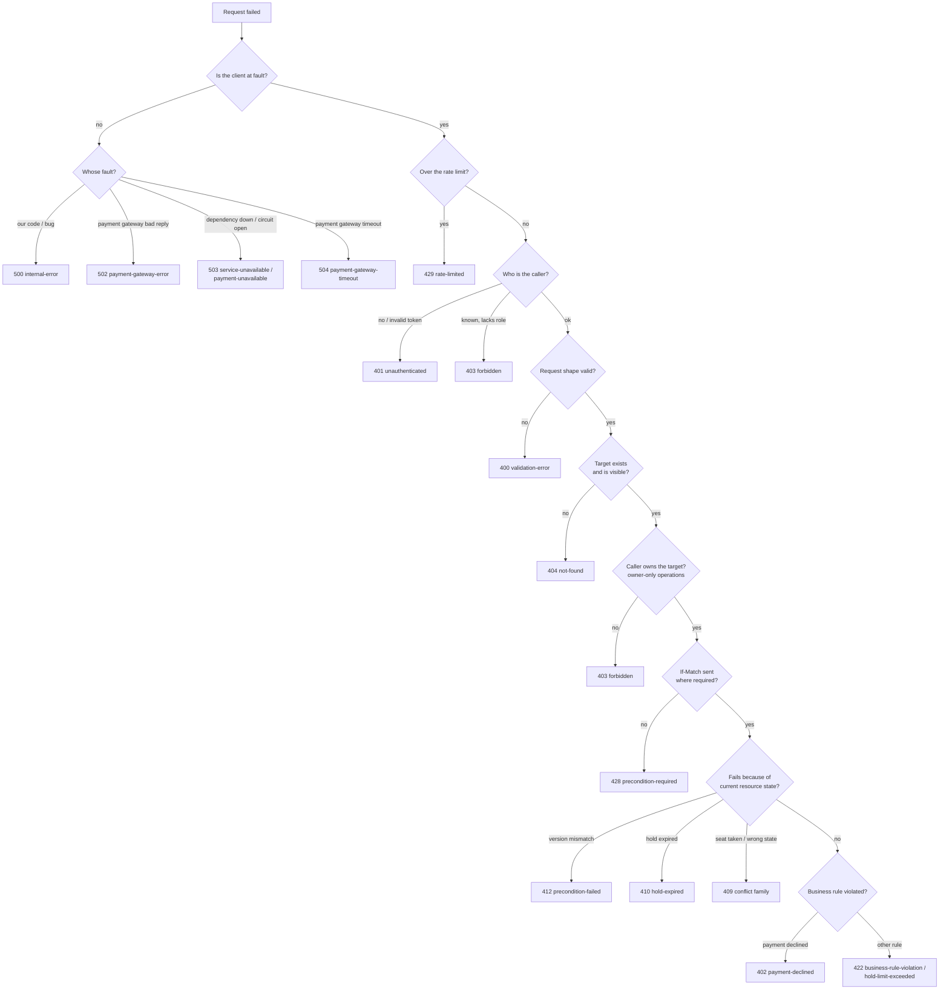
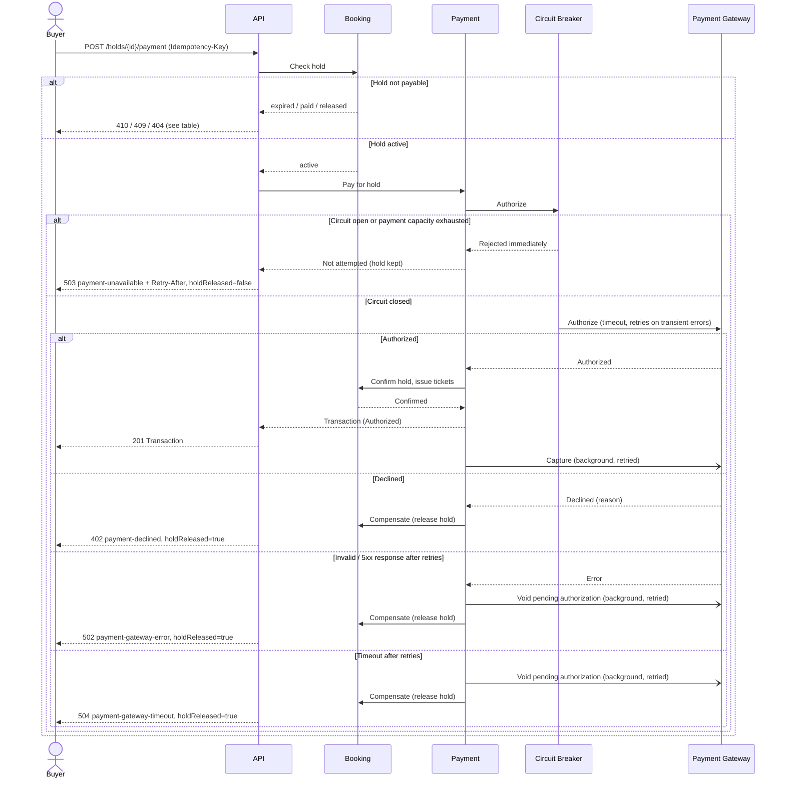
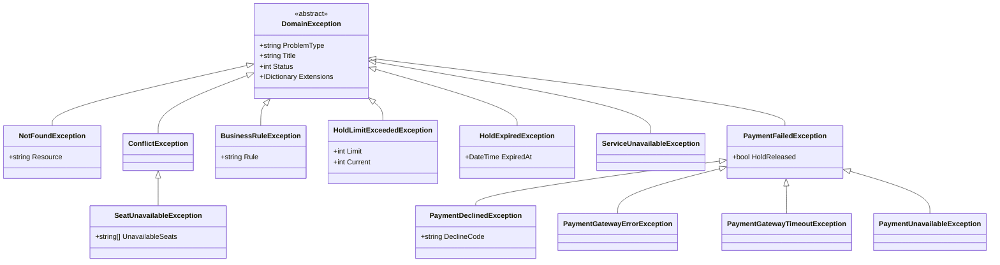
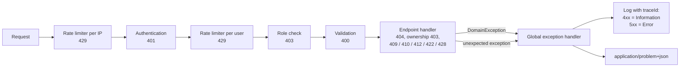

# Ticketium — Error Handling Design

This document defines how the Ticketium API reports errors. The machine-readable contract
is the OpenAPI specification [openapi.yaml](./openapi.yaml), which describes 11 endpoints
with all of their success and error responses.

See also: [SRS](./SRS.md) for requirements and [Architecture](./ARCHITECTURE.md) for the
modules and the booking saga referenced below. [Error Scenarios](./ERROR_SCENARIOS.md)
([PDF](./ERROR_SCENARIOS.pdf)) walks through an example request, error response and client
reaction for every error of every endpoint.

> **Viewing the spec:** [open openapi.yaml in Swagger Editor](https://editor.swagger.io/?url=https://raw.githubusercontent.com/hrytsykvl/Ticketium/main/docs/openapi.yaml),
> or paste the contents of `openapi.yaml` into [editor.swagger.io](https://editor.swagger.io/).

## 1. Principles

1. **One error format everywhere.** Every non-2xx response is an
   [RFC 9457](https://www.rfc-editor.org/rfc/rfc9457) *Problem Details* object with the
   media type `application/problem+json`. This also covers framework-generated errors
   (routing `404`, model binding `400`, authentication `401`).
2. **The `type` is the contract.** Clients branch on `type`, never on `detail` text.
   `title` is fixed per type; `detail` is for humans and may change.
3. **Correct HTTP semantics.** The status code alone must tell a generic client (proxy,
   retry policy, browser) what class of failure happened and whether retrying can help.
4. **No internal leakage.** Stack traces, SQL, exception messages and gateway responses are
   logged, never returned. `5xx` responses carry a generic `detail` and a `traceId`.
5. **Every error is traceable.** `traceId` (the W3C `traceparent` of the request) appears in
   the response and in all logs for the request.
6. **Failures never corrupt booking state.** Errors in the payment flow trigger the saga
   compensation described in [Architecture §5](./ARCHITECTURE.md#5-key-flow--concurrency-safe-seat-booking),
   and the response states explicitly whether the seats were released.

## 2. Problem Details Format

| Member     | Required | Description |
|------------|----------|-------------|
| `type`     | yes      | URI identifying the problem type, `https://ticketium.example/problems/{slug}`. |
| `title`    | yes      | Short summary of the problem type. Same for every occurrence. |
| `status`   | yes      | HTTP status code (duplicated for clients that lose the status line). |
| `detail`   | no       | Explanation of this specific occurrence, safe to show to the user. |
| `instance` | no       | Path of the request that failed. |
| `traceId`  | yes*     | Extension. W3C `traceparent` of the request (contains the trace id). *Always set by the server. |

Problem-specific **extension members** (RFC 9457 §3.2) carry data the client needs to
react, e.g. `unavailableSeats`, `holdReleased`, `errors`.

```http
HTTP/1.1 409 Conflict
Content-Type: application/problem+json

{
  "type": "https://ticketium.example/problems/seat-unavailable",
  "title": "Seat is not available",
  "status": 409,
  "detail": "1 of 2 requested seats is already held or sold.",
  "instance": "/api/v1/events/3fa85f64-5717-4562-b3fc-2c963f66afa6/holds",
  "traceId": "00-8f90a1b2c3d4e5f68f90a1b2c3d4e5f6-8f90a1b2c3d4e5f6-01",
  "unavailableSeats": ["A-12"]
}
```

### 2.1 Validation errors

Validation errors list every invalid value at once, in the format of the RFC 9457 §3
example. Exactly one of `pointer` (JSON Pointer into the body), `parameter` (query/path) or
`header` locates the value:

```json
{
  "type": "https://ticketium.example/problems/validation-error",
  "title": "One or more validation errors occurred",
  "status": 400,
  "detail": "The request contains 2 invalid values.",
  "instance": "/api/v1/auth/sign-up",
  "traceId": "00-5c6d7e8f90a1b2c35c6d7e8f90a1b2c3-5c6d7e8f90a1b2c3-01",
  "errors": [
    { "pointer": "#/email",    "detail": "Must be a valid email address." },
    { "pointer": "#/password", "detail": "Must be at least 8 characters long." }
  ]
}
```

### 2.2 Generic HTTP errors

Errors that need no extra semantics beyond the status code (`404` for an unknown route,
`405`, `406`, `415`) use `"type": "about:blank"` with `title` set to the standard reason
phrase, as RFC 9457 §4.2.1 recommends. `404 not-found` is reserved for a known route whose
resource does not exist, and always names the `resource`.

## 3. Status Code Policy



Rules that resolve the usual ambiguities:

| Question | Decision |
|----------|----------|
| Order of checks | Rate limit, authentication, role, request shape, existence, ownership, preconditions, state, business rules — the order of the diagram above. Role checks need only the token, so they run before validation; ownership needs the loaded resource, so it runs after the `404` check. |
| `400` vs `422` | `400` — the request violates the schema (types, formats, lengths, required fields, order of dates), detectable without reading data. `422` — the request is valid but breaks a business rule that needs data to check (venue double-booking, price change after sales opened, hold limit). |
| `409` vs `422` | `409` — the resource the request acts on (the account email, the event, the hold, a requested seat) is in a conflicting state: it already exists, is cancelled, is paid, or is held by someone else. `422` — the values sent break a rule evaluated over other data (schedules of other events, the event's sales window, the buyer's other holds); the client fixes it by sending different values. |
| `410` vs `404` for holds | An expired hold returns `410` so the client knows the seats were released and must re-select, rather than assuming a broken link. A hold released by the buyer no longer exists for the API and returns `404`. |
| `403` vs `404` | Public resources (events) return `403` when the caller lacks rights. Private resources (holds, tickets) of another user return `404`, so their ids cannot be enumerated. |
| Sign-in failure | Unknown email and wrong password both return the same `401 invalid-credentials`. |

## 4. Problem Type Catalogue

Base URI: `https://ticketium.example/problems/`. Retryable: **yes** — the same request may
succeed later; **after fix** — the client must change the request first; **after sign-in** —
repeat with a fresh token; **after reload** — fetch the resource, then re-apply the change;
**new hold** — the hold is gone, the buyer must hold seats again; **no** — a different
action is required.

| Slug | Status | Title | When | Extensions | Retryable |
|------|--------|-------|------|------------|-----------|
| `validation-error` | 400 | One or more validation errors occurred | Body, query, path or header fails validation | `errors[]` | after fix |
| `unauthenticated` | 401 | Authentication required | JWT missing, malformed or expired (also sets `WWW-Authenticate`) | — | after sign-in |
| `invalid-credentials` | 401 | Invalid credentials | Sign-in with wrong email/password | — | after fix |
| `forbidden` | 403 | Access denied | Role or ownership check failed | — | no |
| `not-found` | 404 | Resource not found | Event, venue, hold or seat does not exist / is not visible; a hold released by the buyer | `resource` | no |
| `payment-declined` | 402 | Payment was declined | Gateway declined the authorization | `declineCode`, `holdReleased` | new hold |
| `email-already-registered` | 409 | Email is already registered | Sign-up with an existing email | — | no |
| `event-not-modifiable` | 409 | Event cannot be modified | Editing a cancelled or already started event | — | no |
| `event-already-cancelled` | 409 | Event is already cancelled | Cancelling an event that is already cancelled | — | no |
| `event-already-started` | 409 | Event has already started | Cancelling an event after its start time | — | no |
| `event-not-on-sale` | 409 | Event is not on sale | Holding seats of an event that is cancelled, sold out, not yet on sale or closed; paying for a hold whose event was cancelled | — | no |
| `seat-unavailable` | 409 | Seat is not available | Requested seat already held or sold (FR-9) | `unavailableSeats[]` | after fix |
| `hold-already-paid` | 409 | Hold is already paid | Paying or releasing a hold that was converted into tickets | — | no |
| `idempotency-key-reused` | 409 | Idempotency key reused with a different request | Same `Idempotency-Key`, different request (path or body) | — | after fix |
| `request-in-progress` | 409 | Request is already in progress | Concurrent request with the same `Idempotency-Key` | — | yes |
| `hold-expired` | 410 | Hold has expired | Paying after the hold TTL elapsed (FR-11) | `expiredAt`, `holdReleased: true` | new hold |
| `precondition-failed` | 412 | Resource was modified | `If-Match` does not match the current `ETag` | — | after reload |
| `business-rule-violation` | 422 | Business rule violated | Event create/update breaks a domain rule | `rule` | after fix |
| `hold-limit-exceeded` | 422 | Hold limit exceeded | Buyer would hold more than 6 seats per event | `limit`, `current` | after fix |
| `precondition-required` | 428 | Precondition required | `If-Match` missing on `PUT /events/{eventId}` | — | after fix |
| `rate-limited` | 429 | Too many requests | Per-IP, per-user or per-email limit exceeded (NFR-5) | `Retry-After` header | yes |
| `internal-error` | 500 | An unexpected error occurred | Unhandled exception | — | yes |
| `payment-gateway-error` | 502 | Payment provider error | Gateway returned an invalid / 5xx response after retries | `holdReleased` | new hold |
| `service-unavailable` | 503 | Service temporarily unavailable | Database or seat-lock store unreachable | `Retry-After` header | yes |
| `payment-unavailable` | 503 | Payment is temporarily unavailable | Payment circuit breaker is open or payment capacity is exhausted (NFR-7) | `holdReleased: false`, `Retry-After` | yes |
| `payment-gateway-timeout` | 504 | Payment provider timed out | Gateway did not answer within the timeout after retries | `holdReleased` | new hold |

## 5. Endpoints and Their Outcomes

All endpoints may additionally return `429`, `500` and `503 service-unavailable`. Base path: `/api/v1`.

| # | Endpoint | Success | Error responses |
|---|----------|---------|-----------------|
| 1 | `POST /auth/sign-up` | 201 | 400 validation-error, 409 email-already-registered |
| 2 | `POST /auth/sign-in` | 200 | 400 validation-error, 401 invalid-credentials |
| 3 | `GET /events` | 200 | 400 validation-error |
| 4 | `POST /events` | 201 | 400, 401, 403 forbidden, 404 venue not-found, 422 business-rule-violation |
| 5 | `GET /events/{eventId}` | 200 | 400, 404 not-found |
| 6 | `PUT /events/{eventId}` | 200 | 400, 401, 403, 404, 409 event-not-modifiable, 412 precondition-failed, 422 business-rule-violation, 428 precondition-required |
| 7 | `POST /events/{eventId}/cancellation` | 201 | 400, 401, 403, 404, 409 event-already-cancelled / event-already-started |
| 8 | `POST /events/{eventId}/holds` | 201 | 400, 401, 403 forbidden, 404 event / seat not-found, 409 seat-unavailable / event-not-on-sale, 422 hold-limit-exceeded, 503 service-unavailable |
| 9 | `DELETE /holds/{holdId}` | 204 | 400, 401, 404, 409 hold-already-paid |
| 10 | `POST /holds/{holdId}/payment` | 201 | 400, 401, 402 payment-declined, 403 forbidden, 404, 409 hold-already-paid / idempotency-key-reused / request-in-progress / event-not-on-sale, 410 hold-expired, 502, 503 payment-unavailable, 504 |
| 11 | `GET /me/tickets` | 200 | 400, 401 |

Holding seats and paying are Buyer-only operations (FR-3); `GET /me/tickets` is open to every
signed-in user and returns an empty page for users without purchases. Every new account is a
Buyer; the Organizer role is granted by an administrator outside this API version.

Venue management (FR-5) is not part of this API version: venues are set up by an
administrator and referenced by id when an event is created, and an unknown venue id returns
`404 not-found` with `resource: venue`.

Cancelling an event is modelled as `POST .../cancellation` rather than `DELETE /events/{eventId}`:
the event is not removed (it stays visible as `Cancelled`, and its tickets and transactions are
kept for refunds and audit), so `DELETE` semantics — a subsequent `GET` returning `404` — would
be wrong. `POST` also allows a request body with the cancellation reason. By contrast,
`DELETE /holds/{holdId}` is used because a released hold ceases to exist for the API: a later
payment for it returns `404`. Its record is kept only internally, for audit.

## 6. Failure Semantics of Booking and Payment

Holding and paying for seats are the only operations with side effects outside one database
transaction, so their error behavior is specified precisely.

### 6.1 Holds

- A hold request is **all-or-nothing**: all requested seats are checked and locked in one
  atomic operation. If any seat is taken, no seat is locked and `409 seat-unavailable` lists
  the conflicting seats so the UI can highlight them.
- A seat label that does not exist in the event's seat map returns `404 not-found` with
  `resource: seat`, the same way an unknown venue id is reported when creating an event.
- The limit of 6 held seats per buyer per event is checked inside the same atomic operation
  that acquires the locks, so parallel hold requests of one buyer (e.g. from two browser
  tabs) cannot exceed it together; the losing request gets `422 hold-limit-exceeded`.
- The hold is stored in the same database transaction that re-checks that the event is on
  sale. If the event was cancelled or sales closed in the meantime, the locks are released
  and `409 event-not-on-sale` is returned, so no hold can outlive a cancellation.
- If the seat-lock store is unreachable, the API fails closed with `503 service-unavailable`
  — it never falls back to an unlocked booking (NFR-6).
- `DELETE /holds/{id}` is idempotent: releasing an already released or expired hold returns `204`.

### 6.2 Payment

`POST /holds/{holdId}/payment` requires an `Idempotency-Key` header. The server stores the
key with a hash of the request (method, path and body) and the final response for 24 hours:

- same key, same request → the stored response is replayed (no second charge);
- same key, different request (another hold or another body) → `409 idempotency-key-reused`;
- same key while the first request is still running → `409 request-in-progress`.

Two kinds of responses are **not stored**, because the checkout did not complete: `503`
(`payment-unavailable` — no authorization was attempted; `service-unavailable` — a dependency
was unreachable) and `500 internal-error`. For them the key is released, so a retry with the
same key runs the checkout again. This is safe after a `500` too: the saga resumes from its
saved state and the gateway deduplicates the authorization by the hold reference.

This makes it safe for the client to retry after a network error without paying twice.

A payment is executed as **authorize, then capture**: the amount is authorized first, the
booking is confirmed (the API answers `201` at this point, with transaction status
`Authorized`), and the payment is captured in the background. A failed checkout therefore
voids an authorization instead of refunding money (see
[Concurrency Patterns S2](./CONCURRENCY_PATTERNS.md#2-s2-paying-for-a-hold-checkout-saga)).

The hold is checked before anything is authorized:

| Hold state | Response |
|------------|----------|
| `Active`, not expired | Checkout runs (diagram below) |
| Expired | `410 hold-expired` |
| `Paid` | `409 hold-already-paid` |
| `Released` because the event was cancelled | `409 event-not-on-sale` |
| `Released` by the buyer, unknown, or another user's | `404 not-found` |

If the hold's state changes while the amount is being authorized (it expires, the buyer
releases it, or the event is cancelled), the confirm step fails, the authorization is voided
and the same response as in the table is returned.



Design decisions:

- **Release on failure** follows FR-11 and the saga in the Architecture document: seats go
  back on sale immediately, so other buyers are not blocked by a failed checkout.
- **Keep on open circuit:** when the breaker is open (or the payment bulkhead is full) no
  authorization was attempted, so there is nothing to compensate; the hold stays until its
  TTL and the buyer can retry. FR-11 releases holds only when a payment attempt failed.
- **Invalid responses and timeouts are ambiguous** — the gateway may have authorized the
  amount. The payment module voids the authorization with the same idempotency reference,
  and a reconciliation job voids any authorization that is later found without a ticket.
  Because nothing is captured before the booking is confirmed, the buyer is never charged
  for a failed checkout; at most an amount is reserved on the card for a short time.
- Only transient gateway errors (connection failure, `5xx`, timeout) are retried inside the
  breaker. Declines are never retried. Strong customer authentication (3-D Secure) is
  completed by the gateway's client SDK before the `paymentToken` is issued, so the server
  never has to pause a checkout for it.

## 7. Client Handling Guidance

| Situation | Client behavior |
|-----------|-----------------|
| `400` | Show `errors[].detail` next to the matching fields (`pointer` → form field, `parameter` → filter or URL value). Do not retry unchanged. |
| `401 unauthenticated` | Keep the user's input, redirect to sign-in, then let the user repeat the action. |
| `401 invalid-credentials` | Show "The email or password is incorrect" without saying which. |
| `402 payment-declined` | Show a message for `declineCode`. The hold is released: return to the seat map with the previous selection. |
| `403` | Show "You don't have permission"; do not retry. |
| `404` | Branch on `resource`: `seat` — reload the seat map; `venue` — choose another venue; `hold` — clear the checkout state; `event` — show "not available". Do not retry unchanged. |
| `409 seat-unavailable` | Mark `unavailableSeats` as taken on the seat map and let the buyer pick again. |
| `409 hold-already-paid` | Show "Already paid" and open "My tickets". |
| `409 event-*` | Reload the event and show its current status. |
| `409 request-in-progress` | Wait for the response to the first request; resend with the same key only if that response is lost. |
| `409 idempotency-key-reused` | Client bug: log it, generate a new key and let the user repeat the action. |
| `410 hold-expired`, `holdReleased: true` | Show "your reservation expired" and return to the seat map. |
| `412` | Reload the event, show the latest data, let the organizer re-apply changes. |
| `422` | Show `detail`. For `business-rule-violation` highlight the fields of `rule`; for `hold-limit-exceeded` show how many seats are left (`limit - current`). |
| `428` | Client bug: log it, reload the event and send its `ETag` in `If-Match`. |
| `429` | Never retry before `Retry-After`. Background reads (e.g. reloading a page's data) are retried automatically after `Retry-After` with exponential backoff and jitter (max 3 attempts). User actions (sign-in, hold, payment) are not retried automatically: the action is disabled with a countdown and the user repeats it. |
| `503` | Wait `Retry-After` seconds, then retry with exponential backoff and jitter (max 3 attempts). For payment, retry with the **same** `Idempotency-Key` while the hold is active. |
| `500` | Show a generic message with `traceId`. A payment may be retried once with the **same** `Idempotency-Key`. |
| `502`, `504` | Show "the payment could not be completed; any amount reserved on your card will be released" with `traceId`. `holdReleased` is `true`: return to the seat map; a new attempt needs a new hold and a new `Idempotency-Key`. |
| Network error during payment | Retry with the **same** `Idempotency-Key` — the server replays the result. |

## 8. Server-side Design

### 8.1 Exception hierarchy

Modules throw typed domain exceptions; only the API layer knows about HTTP. One global
handler translates them into Problem Details.



### 8.2 Request pipeline



The per-IP limiter runs first because the caller is not known yet; the per-user limiter runs
once the token is validated. Failed sign-ins are additionally limited per email inside the
sign-in handler.

### 8.3 Logging and monitoring

- `4xx` are logged at *Information* (expected business outcomes), `5xx` at *Error* with the
  full exception. Request bodies containing passwords or payment tokens are never logged.
- Metrics are emitted per `type` (e.g. rate of `seat-unavailable`, `payment-unavailable`),
  so a spike in `payment-unavailable` alerts operators about a gateway outage (Actor 3 in the SRS).

### 8.4 ASP.NET Core implementation notes

The design maps directly onto built-in ASP.NET Core features:

```csharp
builder.Services.AddProblemDetails(options =>
    options.CustomizeProblemDetails = ctx =>
    {
        ctx.ProblemDetails.Instance = ctx.HttpContext.Request.Path;
        ctx.ProblemDetails.Extensions["traceId"] = Activity.Current?.Id ?? ctx.HttpContext.TraceIdentifier;
    });
builder.Services.AddExceptionHandler<DomainExceptionHandler>(); // DomainException -> ProblemDetails

app.UseExceptionHandler();
app.UseStatusCodePages(); // framework 404/405/415 also become problem+json
```

- `DomainExceptionHandler : IExceptionHandler` copies `ProblemType`, `Title`, `Status` and
  `Extensions` from the exception; any other exception becomes `500 internal-error`.
- `Activity.Current?.Id` is the W3C `traceparent` (`00-{trace id}-{span id}-{flags}`), the
  format used for `traceId` in all examples.
- Model validation is configured to produce the `errors[]` array of §2.1 instead of the
  default ASP.NET dictionary format.
- The payment gateway client uses Polly (`Microsoft.Extensions.Http.Resilience`) for timeout,
  retry, circuit breaker and a concurrency limiter (bulkhead); `BrokenCircuitException` and
  `RateLimiterRejectedException` map to `503 payment-unavailable`.

## 9. Traceability

| Requirement | Covered by |
|-------------|------------|
| FR-1, FR-2 | `email-already-registered`, `invalid-credentials`, `validation-error` |
| FR-3, NFR-4 | `unauthenticated`, `forbidden` (Organizer-only and Buyer-only operations), `403` vs `404` policy |
| FR-4 | `business-rule-violation`, `event-not-modifiable`, `event-already-cancelled`, `event-already-started`, `precondition-failed` |
| FR-5 | Not in this API version; an unknown venue id returns `not-found` with `resource: venue` |
| FR-8, FR-9 | `seat-unavailable`, `event-not-on-sale`, `hold-limit-exceeded`, `not-found` (`resource: seat`), `service-unavailable` (fail closed) |
| FR-10 – FR-12, NFR-7 | `payment-*` problems, `holdReleased`, idempotency, §6.2 saga |
| FR-11 | `hold-expired`, release on payment failure |
| FR-15 | `event-not-on-sale` for payments of holds released by a cancellation |
| NFR-5 | `rate-limited` |
| C-1 | `paymentToken` only — no card data in requests or error responses |
