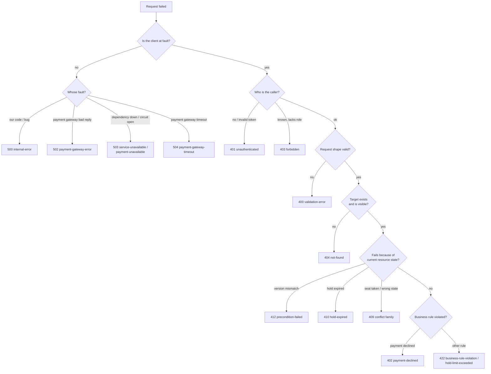
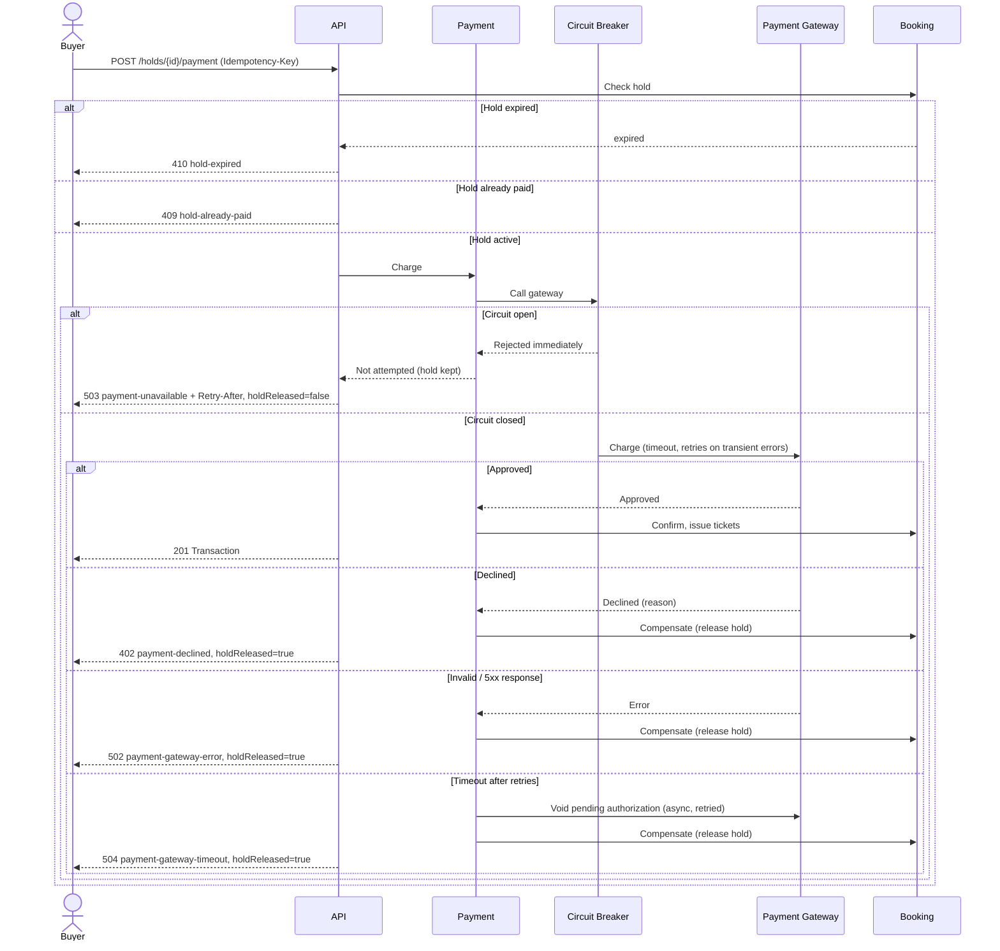
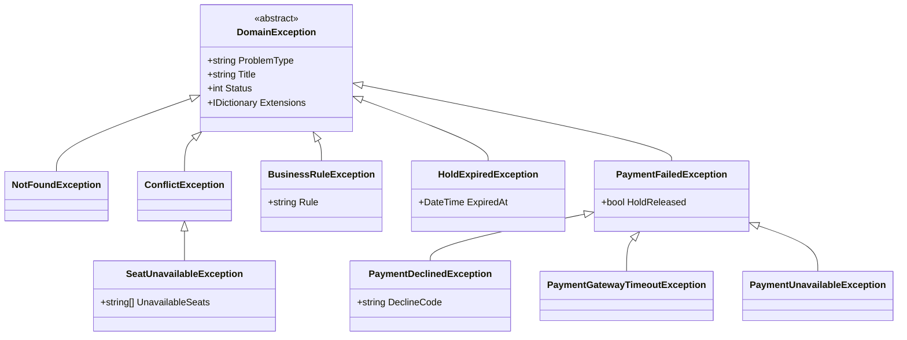
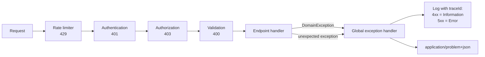

# Ticketium — Error Handling Design

This document defines how the Ticketium API reports errors. The machine-readable contract
is the OpenAPI specification [openapi.yaml](./openapi.yaml), which describes 11 endpoints
with all of their success and error responses.

See also: [SRS](./SRS.md) for requirements and [Architecture](./ARCHITECTURE.md) for the
modules and the booking saga referenced below. [Error Scenarios](./ERROR_SCENARIOS.md)
([PDF](./ERROR_SCENARIOS.pdf)) walks through an example request, error response and client
reaction for every error of every endpoint.

> **Viewing the spec:** [open openapi.yaml in Swagger Editor](https://editor.swagger.io/?url=https://raw.githubusercontent.com/hrytsykvl/Ticketium/main/docs/openapi.yaml),
> or paste the contents of `openapi.yaml` into [editor.swagger.io](https://editor.swagger.io/).

## 1. Principles

1. **One error format everywhere.** Every non-2xx response is an
   [RFC 9457](https://www.rfc-editor.org/rfc/rfc9457) *Problem Details* object with the
   media type `application/problem+json`. This also covers framework-generated errors
   (routing `404`, model binding `400`, authentication `401`).
2. **The `type` is the contract.** Clients branch on `type`, never on `detail` text.
   `title` is fixed per type; `detail` is for humans and may change.
3. **Correct HTTP semantics.** The status code alone must tell a generic client (proxy,
   retry policy, browser) what class of failure happened and whether retrying can help.
4. **No internal leakage.** Stack traces, SQL, exception messages and gateway responses are
   logged, never returned. `5xx` responses carry a generic `detail` and a `traceId`.
5. **Every error is traceable.** `traceId` (W3C trace context) appears in the response and
   in all logs for the request.
6. **Failures never corrupt booking state.** Errors in the payment flow trigger the saga
   compensation described in [Architecture §5](./ARCHITECTURE.md#5-key-flow--concurrency-safe-seat-booking),
   and the response states explicitly whether the seats were released.

## 2. Problem Details Format

| Member     | Required | Description |
|------------|----------|-------------|
| `type`     | yes      | URI identifying the problem type, `https://ticketium.example/problems/{slug}`. |
| `title`    | yes      | Short summary of the problem type. Same for every occurrence. |
| `status`   | yes      | HTTP status code (duplicated for clients that lose the status line). |
| `detail`   | no       | Explanation of this specific occurrence, safe to show to the user. |
| `instance` | no       | Path of the request that failed. |
| `traceId`  | yes*     | Extension. W3C trace id of the request. *Always set by the server. |

Problem-specific **extension members** (RFC 9457 §3.2) carry data the client needs to
react, e.g. `unavailableSeats`, `holdReleased`, `errors`.

```http
HTTP/1.1 409 Conflict
Content-Type: application/problem+json

{
  "type": "https://ticketium.example/problems/seat-unavailable",
  "title": "Seat is not available",
  "status": 409,
  "detail": "1 of 2 requested seats is already held or sold.",
  "instance": "/api/v1/events/3fa85f64-5717-4562-b3fc-2c963f66afa6/holds",
  "traceId": "00-8f90a1b2c3d4e5f68f90a1b2c3d4e5f6-8f90a1b2c3d4e5f6-01",
  "unavailableSeats": ["A-12"]
}
```

### 2.1 Validation errors

Validation errors list every invalid value at once, in the format of the RFC 9457 §3
example. Exactly one of `pointer` (JSON Pointer into the body), `parameter` (query/path) or
`header` locates the value:

```json
{
  "type": "https://ticketium.example/problems/validation-error",
  "title": "One or more validation errors occurred",
  "status": 400,
  "detail": "The request contains 2 invalid values.",
  "instance": "/api/v1/auth/sign-up",
  "traceId": "00-5c6d7e8f90a1b2c35c6d7e8f90a1b2c3-5c6d7e8f90a1b2c3-01",
  "errors": [
    { "pointer": "#/email",    "detail": "Must be a valid email address." },
    { "pointer": "#/password", "detail": "Must be at least 8 characters long." }
  ]
}
```

### 2.2 Generic HTTP errors

Errors that need no extra semantics beyond the status code (`405`, `406`, `415`) use
`"type": "about:blank"` with `title` set to the standard reason phrase, as RFC 9457 §4.2.1
recommends.

## 3. Status Code Policy



Rules that resolve the usual ambiguities:

| Question | Decision |
|----------|----------|
| `400` vs `422` | `400` — the request violates the schema (types, formats, lengths, required fields), detectable without reading data. `422` — the request is valid but breaks a business rule that needs data to check (venue double-booking, capacity below sold tickets, hold limit). |
| `409` vs `422` | `409` — the request could succeed if the **resource state** were different (seat held by someone else, event cancelled, hold already paid). `422` — the request itself is unacceptable regardless of timing. |
| `410` vs `404` for holds | An expired hold returns `410` so the client knows the seats were released and must re-select, rather than assuming a broken link. |
| `403` vs `404` | Public resources (events) return `403` when the caller lacks rights. Private resources (holds, tickets) of another user return `404`, so their ids cannot be enumerated. |
| Sign-in failure | Unknown email and wrong password both return the same `401 invalid-credentials`. |

## 4. Problem Type Catalogue

Base URI: `https://ticketium.example/problems/`. Retryable: **yes** — the same request may
succeed later; **after fix** — the client must change the request first; **no** — a different
action is required.

| Slug | Status | Title | When | Extensions | Retryable |
|------|--------|-------|------|------------|-----------|
| `validation-error` | 400 | One or more validation errors occurred | Body, query, path or header fails validation | `errors[]` | after fix |
| `unauthenticated` | 401 | Authentication required | JWT missing, malformed or expired (also sets `WWW-Authenticate`) | — | after sign-in |
| `invalid-credentials` | 401 | Invalid credentials | Sign-in with wrong email/password | — | after fix |
| `forbidden` | 403 | Access denied | Role or ownership check failed | — | no |
| `not-found` | 404 | Resource not found | Event, venue, hold or seat does not exist / is not visible | `resource` | no |
| `payment-declined` | 402 | Payment was declined | Gateway declined the charge | `declineCode`, `holdReleased` | after fix (new hold) |
| `email-already-registered` | 409 | Email is already registered | Sign-up with an existing email | — | no |
| `event-not-modifiable` | 409 | Event cannot be modified | Editing a cancelled or finished event | — | no |
| `event-already-cancelled` | 409 | Event is already cancelled | Cancelling an event that is already cancelled | — | no |
| `event-already-started` | 409 | Event has already started | Cancelling an event after its start time | — | no |
| `event-not-on-sale` | 409 | Event is not on sale | Holding seats of a cancelled, sold-out or closed event | — | no |
| `seat-unavailable` | 409 | Seat is not available | Requested seat already held or sold (FR-9) | `unavailableSeats[]` | after fix |
| `hold-already-paid` | 409 | Hold is already paid | Paying or releasing a hold that was converted into tickets | — | no |
| `idempotency-key-reused` | 409 | Idempotency key reused with a different request | Same `Idempotency-Key`, different body | — | after fix |
| `request-in-progress` | 409 | Request is already in progress | Concurrent request with the same `Idempotency-Key` | — | yes |
| `hold-expired` | 410 | Hold has expired | Paying after the hold TTL elapsed (FR-11) | `expiredAt` | no (new hold) |
| `precondition-failed` | 412 | Resource was modified | `If-Match` does not match the current `ETag` | — | after reload |
| `business-rule-violation` | 422 | Business rule violated | Event create/update breaks a domain rule | `rule` | after fix |
| `hold-limit-exceeded` | 422 | Hold limit exceeded | Buyer would hold more than 6 seats per event | `limit`, `current` | after fix |
| `precondition-required` | 428 | Precondition required | `If-Match` missing on `PUT /events/{eventId}` | — | after fix |
| `rate-limited` | 429 | Too many requests | Per-user / per-IP limit exceeded (NFR-5) | `Retry-After` header | yes |
| `internal-error` | 500 | An unexpected error occurred | Unhandled exception | — | yes |
| `payment-gateway-error` | 502 | Payment provider error | Gateway returned an invalid / 5xx response | `holdReleased` | after new hold |
| `service-unavailable` | 503 | Service temporarily unavailable | Database or seat-lock store unreachable | `Retry-After` header | yes |
| `payment-unavailable` | 503 | Payment is temporarily unavailable | Payment circuit breaker is open (NFR-7) | `holdReleased: false`, `Retry-After` | yes |
| `payment-gateway-timeout` | 504 | Payment provider timed out | Gateway did not answer within the timeout after retries | `holdReleased` | after new hold |

## 5. Endpoints and Their Outcomes

All endpoints may additionally return `429` and `500`. Base path: `/api/v1`.

| # | Endpoint | Success | Error responses |
|---|----------|---------|-----------------|
| 1 | `POST /auth/sign-up` | 201 | 400 validation-error, 409 email-already-registered |
| 2 | `POST /auth/sign-in` | 200 | 400 validation-error, 401 invalid-credentials |
| 3 | `GET /events` | 200 | 400 validation-error |
| 4 | `POST /events` | 201 | 400, 401, 403 forbidden, 404 venue not-found, 422 business-rule-violation |
| 5 | `GET /events/{eventId}` | 200 | 400, 404 not-found |
| 6 | `PUT /events/{eventId}` | 200 | 400, 401, 403, 404, 409 event-not-modifiable, 412 precondition-failed, 422 business-rule-violation, 428 precondition-required |
| 7 | `POST /events/{eventId}/cancellation` | 201 | 400, 401, 403, 404, 409 event-already-cancelled / event-already-started |
| 8 | `POST /events/{eventId}/holds` | 201 | 400, 401, 404, 409 seat-unavailable / event-not-on-sale, 422 hold-limit-exceeded, 503 service-unavailable |
| 9 | `DELETE /holds/{holdId}` | 204 | 401, 404, 409 hold-already-paid |
| 10 | `POST /holds/{holdId}/payment` | 201 | 400, 401, 402 payment-declined, 404, 409 hold-already-paid / idempotency-key-reused / request-in-progress, 410 hold-expired, 502, 503 payment-unavailable, 504 |
| 11 | `GET /me/tickets` | 200 | 400, 401 |

Cancelling an event is modelled as `POST .../cancellation` rather than `DELETE /events/{eventId}`:
the event is not removed (it stays visible as `Cancelled`, and its tickets and transactions are
kept for refunds and audit), so `DELETE` semantics — a subsequent `GET` returning `404` — would
be wrong. `POST` also allows a request body with the cancellation reason. By contrast,
`DELETE /holds/{holdId}` is used because a released hold really ceases to exist.

## 6. Failure Semantics of Booking and Payment

Holding and paying for seats are the only operations with side effects outside one database
transaction, so their error behavior is specified precisely.

### 6.1 Holds

- A hold request is **all-or-nothing**: if any requested seat is taken, no seat is locked and
  `409 seat-unavailable` lists the conflicting seats so the UI can highlight them.
- If the seat-lock store is unreachable, the API fails closed with `503 service-unavailable`
  — it never falls back to an unlocked booking (NFR-6).
- `DELETE /holds/{id}` is idempotent: releasing an already released or expired hold returns `204`.

### 6.2 Payment

`POST /holds/{holdId}/payment` requires an `Idempotency-Key` header. The server stores the
key with the request hash and the final response for 24 hours:

- same key, same body → the stored response is replayed (no second charge);
- same key, different body → `409 idempotency-key-reused`;
- same key while the first request is still running → `409 request-in-progress`.

This makes it safe for the client to retry after a network error without paying twice.



Design decisions:

- **Release on failure** follows FR-11 and the saga in the Architecture document: seats go
  back on sale immediately, so other buyers are not blocked by a failed checkout.
- **Keep on open circuit:** when the breaker is open no charge was attempted, so there is
  nothing to compensate; the hold stays until its TTL and the buyer can retry.
- **Timeouts are ambiguous** — the gateway may have charged the card. The payment module
  voids the authorization with the same idempotency reference, and a reconciliation job
  refunds any charge that is later found without a ticket.
- Only transient gateway errors (connection failure, `5xx`, timeout) are retried inside the
  breaker. Declines are never retried.

## 7. Client Handling Guidance

| Situation | Client behavior |
|-----------|-----------------|
| `400`, `422` | Show `errors[].detail` next to the matching fields (`pointer` → form field). Do not retry unchanged. |
| `401 unauthenticated` | Redirect to sign-in, then repeat the request. |
| `403`, `404` | Show an error page; do not retry. |
| `409 seat-unavailable` | Mark `unavailableSeats` as taken on the seat map and let the buyer pick again. |
| `410 hold-expired`, `holdReleased: true` | Show "your reservation expired / payment failed" and return to the seat map. |
| `412` | Reload the event, show the latest data, let the organizer re-apply changes. |
| `429`, `503` | Wait `Retry-After` seconds, then retry with exponential backoff and jitter (max 3 attempts). |
| `500`, `502`, `504` | Show a generic message with `traceId`. For payment retry only with the **same** `Idempotency-Key`. |
| Network error during payment | Retry with the **same** `Idempotency-Key` — the server replays the result. |

## 8. Server-side Design

### 8.1 Exception hierarchy

Modules throw typed domain exceptions; only the API layer knows about HTTP. One global
handler translates them into Problem Details.



### 8.2 Request pipeline



### 8.3 Logging and monitoring

- `4xx` are logged at *Information* (expected business outcomes), `5xx` at *Error* with the
  full exception. Request bodies containing passwords or payment tokens are never logged.
- Metrics are emitted per `type` (e.g. rate of `seat-unavailable`, `payment-unavailable`),
  so a spike in `payment-unavailable` alerts operators about a gateway outage (Actor 3 in the SRS).

### 8.4 ASP.NET Core implementation notes

The design maps directly onto built-in ASP.NET Core features:

```csharp
builder.Services.AddProblemDetails(options =>
    options.CustomizeProblemDetails = ctx =>
    {
        ctx.ProblemDetails.Instance = ctx.HttpContext.Request.Path;
        ctx.ProblemDetails.Extensions["traceId"] = Activity.Current?.Id ?? ctx.HttpContext.TraceIdentifier;
    });
builder.Services.AddExceptionHandler<DomainExceptionHandler>(); // DomainException -> ProblemDetails

app.UseExceptionHandler();
app.UseStatusCodePages(); // framework 404/405/415 also become problem+json
```

- `DomainExceptionHandler : IExceptionHandler` copies `ProblemType`, `Title`, `Status` and
  `Extensions` from the exception; any other exception becomes `500 internal-error`.
- Model validation is configured to produce the `errors[]` array of §2.1 instead of the
  default ASP.NET dictionary format.
- The payment gateway client uses Polly (`Microsoft.Extensions.Http.Resilience`) for timeout,
  retry and circuit breaker; `BrokenCircuitException` maps to `503 payment-unavailable`.

## 9. Traceability

| Requirement | Covered by |
|-------------|------------|
| FR-1, FR-2 | `email-already-registered`, `invalid-credentials`, `validation-error` |
| FR-3, NFR-4 | `unauthenticated`, `forbidden`, `403` vs `404` policy |
| FR-4, FR-5 | `business-rule-violation`, `event-not-modifiable`, `event-already-cancelled`, `event-already-started`, `precondition-failed` |
| FR-8, FR-9 | `seat-unavailable`, `hold-limit-exceeded`, `service-unavailable` (fail closed) |
| FR-10 – FR-12, NFR-7 | `payment-*` problems, `holdReleased`, idempotency, §6.2 saga |
| FR-11 | `hold-expired`, release on payment failure |
| NFR-5 | `rate-limited` |
| C-1 | `paymentToken` only — no card data in requests or error responses |
