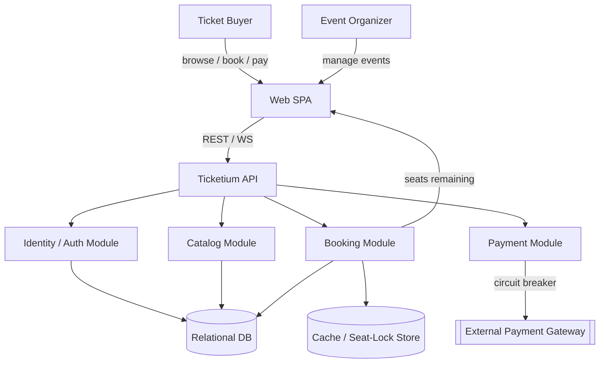
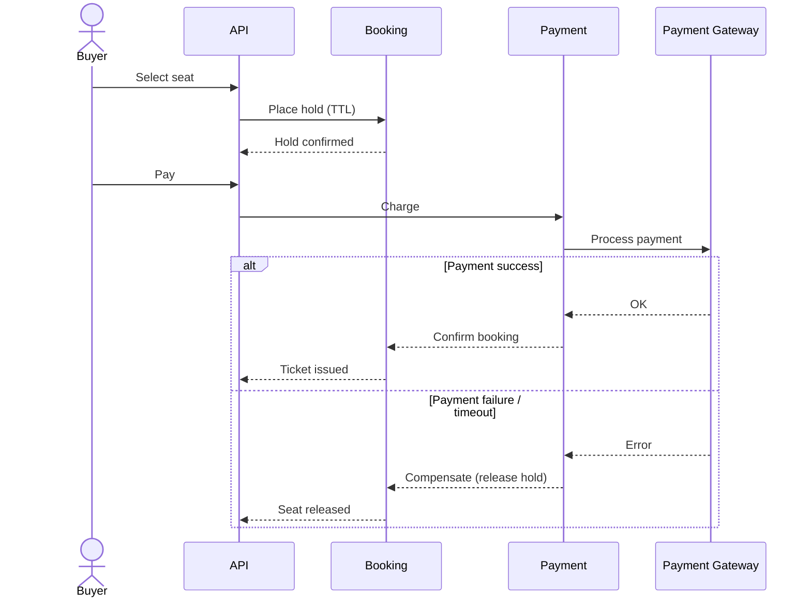

# Software Requirements Specification
## For Ticketium

Version 0.1
Prepared by Vladyslav Hrytsyk, Oleksandr Kuzmeniuk, Danylo Kozlovskyi
Team x53AIBoosted
2026-10-19

## Table of Contents

* [1. Introduction](#1-introduction)
    * [1.1 Document Purpose](#11-document-purpose)
    * [1.2 Product Scope](#12-product-scope)
    * [1.3 Definitions, Acronyms, and Abbreviations](#13-definitions-acronyms-and-abbreviations)
    * [1.4 References](#14-references)
* [2. Product Overview](#2-product-overview)
    * [2.1 Product Perspective](#21-product-perspective)
    * [2.2 High-level Architecture](#22-high-level-architecture)
    * [2.3 Product Functions](#23-product-functions)
    * [2.4 Actors and Personas](#24-actors-and-personas)
    * [2.5 Assumptions and Dependencies](#25-assumptions-and-dependencies)
* [3. Requirements](#3-requirements)
    * [3.1 External Interfaces](#31-external-interfaces)
    * [3.2 Functional Requirements](#32-functional-requirements)
    * [3.3 Quality of Service](#33-quality-of-service)
    * [3.4 Compliance](#34-compliance)
    * [3.5 Design and Implementation](#35-design-and-implementation)
* [4. Verification](#4-verification)

## Revision History

| Name          | Date       | Reason For Changes | Version |
|---------------|------------|--------------------|---------|
| x53AIBoosted  | 2026-10-19 | Initial draft      | 0.1     |

## 1. Introduction

This Software Requirements Specification (SRS) defines the intended purpose, scope, and
requirements for **Ticketium**, an event ticketing and seat reservation system. It describes
what the system must do rather than how it will be implemented, and serves product,
engineering, QA, and operations audiences throughout the software lifecycle.

See also: the project [README](../README.md) for a product summary and the
[Architecture document](./ARCHITECTURE.md) for design and diagrams.

### 1.1 Document Purpose

The purpose of this SRS is to capture the functional and non-functional requirements of
Ticketium so that the development team shares a single, unambiguous understanding of the
product. It is used to guide design, implementation, testing, and acceptance of the system.

### 1.2 Product Scope

Ticketium is a platform that lets **Event Organizers** create events and define seat
capacities, and lets **Ticket Buyers** browse events, select seats, and pay. The central
design concern is **concurrency**: safely handling many users attempting to buy the same
seat at the same time without ever double-selling a seat.

In scope: identity/authentication, event catalog, seat booking with reservation holds,
and payment processing. Out of scope (for this version): native mobile apps, third-party
resale marketplaces, and physical access-control hardware.

### 1.3 Definitions, Acronyms, and Abbreviations

| Term    | Definition                                                                 |
|---------|---------------------------------------------------------------------------|
| API     | Application Programming Interface                                          |
| SRS     | Software Requirements Specification                                        |
| UI      | User Interface                                                             |
| JWT     | JSON Web Token used to represent authenticated user claims                 |
| Hold    | A temporary, time-limited reservation of a seat during checkout           |
| Saga    | A sequence of local transactions with compensating actions on failure     |
| SPA     | Single Page Application                                                    |
| WS      | WebSocket, a protocol for real-time bidirectional communication           |

### 1.4 References

| Title              | Owner  | Location                                                    | Type        |
|--------------------|--------|-------------------------------------------------------------|-------------|
| SRS Template       | jam01  | https://github.com/jam01/SRS-Template                       | Informative |
| Project README     | Team   | [../README.md](../README.md)                                | Informative |
| Architecture Doc   | Team   | [./ARCHITECTURE.md](./ARCHITECTURE.md)                      | Normative   |

## 2. Product Overview

### 2.1 Product Perspective

Ticketium is a new, self-contained product. It integrates with one external dependency — a
payment gateway — accessed through a resilient boundary (timeouts, retries, circuit
breaker). All other capabilities (identity, catalog, booking) are owned by the product.

### 2.2 High-level Architecture

Ticketium is organized into logical modules behind a single API, backed by a relational
store for strong booking consistency and a cache/lock service for seat holds. Real-time
"seats remaining" updates are pushed to clients over WebSockets. For the full architectural
style, container/component views, and data model, see the [Architecture document](./ARCHITECTURE.md).

The booking flow uses a time-limited **hold** on a seat during checkout and a **saga** that
releases the hold if payment fails, guaranteeing no seat is ever double-sold.

### 2.3 Product Functions

- Account registration, authentication, and role-based authorization.
- Event and venue creation and management by organizers.
- Browsing and searching the catalog of events.
- Seat selection with temporary holds during checkout.
- Payment processing with rollback on failure.
- Ticket issuance and retrieval.
- Real-time display of remaining seats.

### 2.4 Actors and Personas

**Actor 1 — Event Organizer (Olena, 34, events manager).**
Creates and manages events and venues, sets seat capacities and pricing, and monitors
sales. Needs reliable capacity control and confidence that seats are never oversold.

**Actor 2 — Ticket Buyer (Maksym, 25, concert-goer).**
Browses events, selects specific seats, and pays quickly on mobile or desktop. Wants a
fast, fair checkout where a selected seat is held long enough to complete payment.

**Actor 3 — System Administrator (secondary).**
Manages users and roles, monitors system health, and handles operational incidents such
as payment-gateway outages.

### 2.5 Assumptions and Dependencies

- An external payment gateway is available and exposes a charge/refund API.
- Users have a modern browser supporting WebSockets.
- A relational database provides transactional guarantees for booking data.

## 3. Requirements

### 3.1 External Interfaces

#### 3.1.1 User Interfaces

Ticketium is accessed through a responsive Web SPA usable on desktop and mobile browsers.
Key screens: event catalog/search, event detail with an interactive seat map, checkout
with a visible hold-expiry countdown, and an "my tickets" area. The UI shall follow a
consistent style guide, surface clear error and empty states, and aim for WCAG 2.1 AA
accessibility. Visual designs are maintained separately and referenced from this SRS.

#### 3.1.2 Software Interfaces

| Interface | Direction | Description |
|-----------|-----------|-------------|
| Ticketium REST API | Provided | JSON/HTTPS API for auth, catalog, booking, and payment operations consumed by the SPA. |
| WebSocket channel | Provided | Pushes real-time "seats remaining" updates to connected clients. |
| External Payment Gateway | Required | Third-party charge/refund API accessed over HTTPS with defined timeout, retry, and circuit-breaker semantics. |
| Relational Database | Required | Transactional system of record for users, events, venues, tickets, and transactions. |
| Cache / Seat-Lock Store | Required | Provides time-limited distributed locks (holds) for seats during checkout. |

Each integration uses authenticated, versioned contracts; the payment gateway boundary
defines explicit error, timeout, and compensation behavior (see §3.3 and the
[Architecture document](./ARCHITECTURE.md)).

### 3.2 Functional Requirements

| ID    | Requirement |
|-------|-------------|
| FR-1  | The system shall allow a user to register an account with email and password. |
| FR-2  | The system shall authenticate users and issue a JWT on successful login. |
| FR-3  | The system shall enforce role-based access, distinguishing Organizers from Buyers. |
| FR-4  | The system shall allow an Organizer to create, edit, and cancel events. |
| FR-5  | The system shall allow an Organizer to define a venue and its seat layout/capacity. |
| FR-6  | The system shall allow a Buyer to browse and search events by name, date, and venue. |
| FR-7  | The system shall allow a Buyer to view the seat map and available seats for an event. |
| FR-8  | The system shall place a time-limited hold on a seat when a Buyer selects it for checkout. |
| FR-9  | The system shall prevent two Buyers from holding or purchasing the same seat concurrently. |
| FR-10 | The system shall process payment for held seats through the external payment gateway. |
| FR-11 | The system shall release a seat hold automatically if payment fails or the hold expires. |
| FR-12 | The system shall issue a ticket and a transaction record upon successful payment. |
| FR-13 | The system shall push real-time "seats remaining" updates to connected clients. |
| FR-14 | The system shall allow a Buyer to view their purchased tickets and order history. |

### 3.3 Quality of Service

The following non-functional requirements constrain and qualify the functional behavior above.

#### 3.3.1 Performance

| ID     | Requirement |
|--------|-------------|
| NFR-1  | The system shall serve catalog and seat-availability reads within 300 ms at the 95th percentile under nominal load. |
| NFR-2  | The system shall handle high-demand ticket drops with controlled queuing and shall scale horizontally to sustain peak booking traffic. |

#### 3.3.2 Security

| ID     | Requirement |
|--------|-------------|
| NFR-3  | Passwords shall be stored hashed and salted; all traffic shall be served over HTTPS (TLS). |
| NFR-4  | Access shall be authorized per role (Organizer, Buyer, Admin) using JWT-based claims. |
| NFR-5  | The system shall mitigate automated abuse (bot/scalping) and DDoS traffic during high-demand drops. |

#### 3.3.3 Reliability

| ID     | Requirement |
|--------|-------------|
| NFR-6  | Booking operations shall be strongly consistent; a seat shall never be sold to more than one Buyer. |
| NFR-7  | The payment integration shall use timeouts, retries, and a circuit breaker so gateway failures do not corrupt booking state, releasing held seats via compensation. |

#### 3.3.4 Availability

| ID     | Requirement |
|--------|-------------|
| NFR-8  | The system shall target 99.5% monthly uptime for core browsing and booking functions. |

#### 3.3.5 Usability

| ID     | Requirement |
|--------|-------------|
| NFR-9  | The checkout flow shall communicate hold expiry clearly and complete in no more than four steps. |

### 3.4 Compliance

| ID    | Requirement |
|-------|-------------|
| C-1   | Payment card handling shall comply with PCI DSS; the system shall not store raw card data and shall delegate card capture to the compliant payment gateway. |
| C-2   | Processing of personal data (accounts, order history) shall comply with GDPR, including consent, data-subject access, and deletion requests. |
| C-3   | Transaction and ticket records shall be retained per applicable financial record-keeping obligations and be exportable for audit. |

### 3.5 Design and Implementation

#### 3.5.1 Installation and Deployment

The system targets cloud container hosting. Components are packaged as container images and
deployed via container apps, with environment-specific configuration and secrets
supplied through environment variables / a secrets manager.

#### 3.5.2 Build and Delivery

Source is built into versioned, reproducible artifacts through a CI pipeline that runs
automated tests before promotion across environments. Dependencies are pinned and scanned.

#### 3.5.3 Technology Constraints

| ID    | Constraint |
|-------|------------|
| D-1   | The booking system of record shall be a relational database providing ACID transactions. |
| D-2   | Seat holds shall use a distributed cache/lock store with TTL support. |
| D-3   | The front end shall be a browser-based SPA communicating via REST and WebSockets. |
| D-4   | External payment access shall be isolated behind a circuit-breaker boundary. |

#### 3.5.4 Maintainability

The backend shall preserve clear module boundaries (Identity, Catalog, Booking, Payment) with
stable internal interfaces, enabling later extraction into independent services without
changing the public API contract.

## 4. Verification

| Requirement | Verification Method |
|-------------|---------------------|
| FR-1 – FR-7, FR-14 | Automated integration tests and manual UI acceptance testing. |
| FR-8, FR-9, FR-11  | Concurrency tests simulating simultaneous seat selection; assert single winner and correct hold release. |
| FR-10, FR-12       | End-to-end tests against a payment-gateway sandbox, including success and failure paths. |
| FR-13              | Automated WebSocket tests asserting availability updates propagate to clients. |
| NFR-6, NFR-7       | Fault-injection and load tests verifying no double-selling and correct circuit-breaker behavior. |
| NFR-1, NFR-2, NFR-8| Load and soak testing against defined performance and availability targets. |
| NFR-3, NFR-4, NFR-5| Security review, access-control tests, and automated dependency/secret scanning. |
| C-1, C-2, C-3      | Compliance audit against PCI DSS / GDPR checklists and retention/export verification. |
